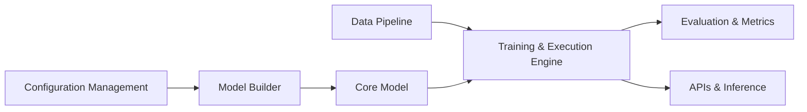

# open-mmlab/mmsegmentation

> OpenMMLab's PyTorch semantic segmentation toolbox, modular and config-driven.

## The problem
Comparing or training segmentation methods requires reimplementing backbones, heads, losses and data pipelines every time.

## What it actually does
Assembles a model by configuration: backbone (ResNet, Swin, ConvNeXt…), neck, decode head, loss. Dozens of methods (PSPNet, DeepLabV3+, SegFormer, Mask2Former, SAN…) and datasets (Cityscapes, ADE20K, VOC…). Training engine on MMEngine, evaluation metrics, inference API, deployment tools. v1.2.0 adds open-vocabulary segmentation and depth estimation.

## How it is wired

## Trying it
No command in the README (it points to get_started.md and dataset_prepare.md).

## Cost and gotchas
Free, Apache-2.0; GPU for training. Last push August 2024; 0.x → 1.x migration to handle.

## What it is not
Not actively maintained: no release since late 2023 according to the README. Not a turnkey tool for non-specialists.

## Alternatives
- MMDetection / MMPreTrain: same ecosystem for detection and pre-training.
- MMDeploy: for deploying OpenMMLab models.

## For you
Ignore for a new project: rich but dormant since 2024; consult only to reproduce a segmentation paper that is already implemented.
