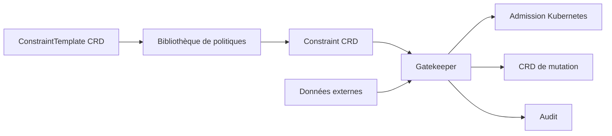

# open-policy-agent/gatekeeper

> Kubernetes admission controller that enforces OPA policies through native resources.

## The problem
With OPA as a kube-mgmt sidecar, policies are not first-class Kubernetes objects.
Parameterizing, auditing and sharing them happens outside the cluster's usual tools.

## What it actually does
An extensible, parameterizable policy library, rather than rules written from scratch each time.
Native CRDs to instantiate these policies: the "constraints".
CRDs to extend the library: the "constraint templates", plus mutation CRDs.
An audit function and support for external data.

## How it is wired

## Trying it
No command documented in the README: it points to the installation instructions on the website.

## Cost and gotchas
Free, but you need a Kubernetes cluster and must accept an admission webhook on the critical path.
An overly broad policy can block legitimate deployments: the audit is there to measure before enforcing.

## What it is not
Not OPA: it is its Kubernetes integration, with deliberate differences compared to the sidecar setup.
Not an after-the-fact security scanner — it acts at admission.
The README does not describe Rego or how to write policies.

## Alternatives
OPA with kube-mgmt (Gatekeeper v1.0): the historical setup, without CRDs or audit.

## For you
Worth knowing if you must enforce rules on a shared cluster; otherwise, nothing for a data workstation.
