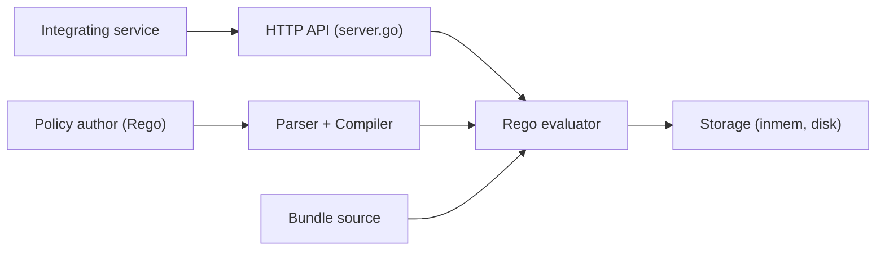

# open-policy-agent/opa

> General-purpose policy engine: services query OPA to decide whether or not to allow something.

## The problem
Access or deployment rules hard-coded in every service are hard to audit and to evolve.

## What it actually does
You write rules in Rego; a service sends a query with input data, OPA evaluates and returns the decision, which the service enforces. Entry points: CLI, HTTP API, Go SDK, WebAssembly evaluation. In-memory or on-disk storage, distribution through bundles.

## How it is wired

## Trying it
No command in the README; it points to the "Running OPA" documentation, the Docker Hub images and the release binaries.

## Cost and gotchas
Free. You have to learn the Rego language. Graduated CNCF project.

## What it is not
Not an authentication tool: it decides, and your service enforces.

## Alternatives
No alternative named in the README.

## For you
Adopt to govern access to models or platform resources declaratively, with a CNCF-graduated project.
