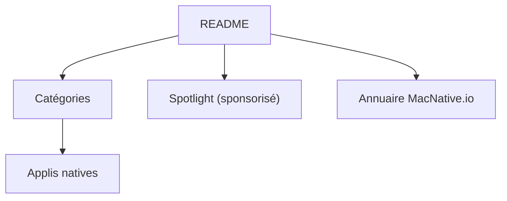

# open-saas-directory/awesome-native-macosx-apps

> List of native macOS apps (Swift, SwiftUI, AppKit), sorted by category, maintained by the MacNative directory.

## The problem
Finding good native Mac apps, outside Electron, requires digging through scattered lists.

## What it actually does
A README with more than thirty categories: AI, databases, developer tools, terminals, window management, clipboard, security. Each line gives the price (free, open source, paid, subscription). Electron apps and web wrappers are excluded. A "Spotlight" section is sponsored.

## How it is wired
Simplified diagram based on the sheet, no diagram provided.



## Trying it
```bash
# Aucune commande documentée : il suffit de lire le README.
```

## Cost and gotchas
Free to read; many listed apps are paid or subscription-based. Spotlight slots are paid for publishers.

## What it is not
Not a 100% neutral catalog: the highlighting is commercial. The repository contains no code.

## Alternatives
- No alternative named in the README, other than the "Awesome Mac Launch Platforms" list.

## For you
Ignore as technical watch: useful for equipping a Mac, no contribution for data, AI or MLOps.
