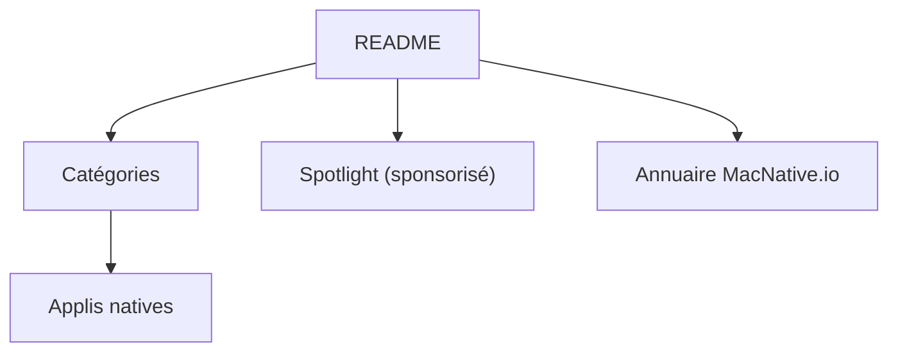

# open-saas-directory/awesome-native-macosx-apps

> Liste d'applis macOS natives (Swift, SwiftUI, AppKit), classées par catégorie, tenue par l'annuaire MacNative.

## Le problème
Trouver de bonnes applis Mac natives, hors Electron, demande de fouiller des listes dispersées.

## Ce que ça fait vraiment
Un README de plus de trente catégories : IA, bases de données, outils développeur, terminaux, gestion de fenêtres, presse-papiers, sécurité. Chaque ligne indique le prix (gratuit, open source, payant, abonnement). Les applis Electron et les enveloppes web sont exclues. Une section « Spotlight » est sponsorisée.

## Comment c'est branché
Schéma simplifié d'après la fiche, sans diagramme fourni.



## Essayer
```bash
# Aucune commande documentée : il suffit de lire le README.
```

## Coût et pièges
Lecture gratuite ; beaucoup d'applis listées sont payantes ou par abonnement. Les emplacements Spotlight sont payants pour les éditeurs.

## Ce que ce n'est pas
Pas un catalogue neutre à 100 % : la mise en avant est commerciale. Le dépôt ne contient aucun code.

## Alternatives
- Aucune alternative nommée dans le README, hormis la liste « Awesome Mac Launch Platforms ».

## Pour toi
À ignorer comme veille technique : utile pour équiper un Mac, sans apport pour data, IA ou MLOps.

