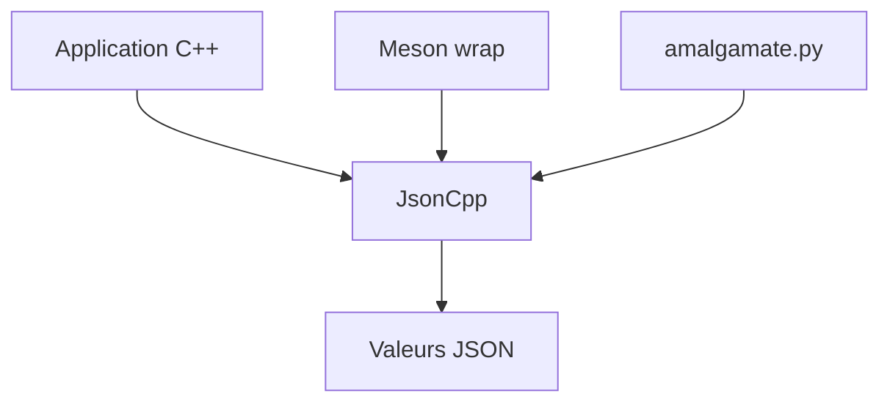

# open-source-parsers/jsoncpp

> C++ library to read, manipulate and write JSON, preserving comments.

## The problem
Handling JSON in C++ requires a reliable parser, including on older toolchains, that keeps the comments in user-written files.

## What it actually does
JsonCpp manipulates JSON values and serializes and deserializes them from strings. It preserves existing comments. The project is in maintenance mode: security, compiler compatibility and regression fixes. Performance and new formats are out of scope.

## How it is wired
Simplified diagram based on the sheet, no diagram provided.



## Trying it
```bash
meson wrap install jsoncpp
python3 amalgamate.py
python3 doxybuild.py --open
```

## Cost and gotchas
Free. A C++11 compiler is required for the `1.y.z` branch. The vcpkg and Conan packages are maintained by the community, not by the project. License not identified by GitHub.

## What it is not
It is not a fast parser: the README declines to compete with SIMD parsers. It does not accept major new features. The `0.y.z` branch only receives security fixes.

## Alternatives
No alternative named in the README.

## For you
Ignore: low-level C++ library, useful only if you write C++ and care about comments in JSON.
