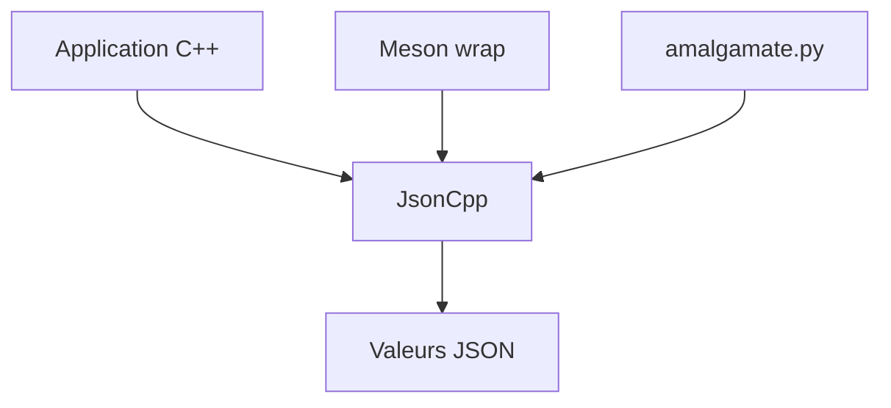

# open-source-parsers/jsoncpp

> Bibliothèque C++ pour lire, manipuler et écrire du JSON, avec conservation des commentaires.

## Le problème
Manipuler du JSON en C++ demande un analyseur fiable, y compris sur d'anciennes chaînes de compilation, et qui garde les commentaires des fichiers saisis par l'utilisateur.

## Ce que ça fait vraiment
JsonCpp manipule des valeurs JSON, les sérialise et les désérialise depuis des chaînes. Il préserve les commentaires existants. Le projet est en mode maintenance : sécurité, compatibilité des compilateurs et correction de régressions. La performance et les nouveaux formats sont hors périmètre.

## Comment c'est branché
Schéma simplifié d'après la fiche, sans diagramme fourni.



## Essayer
```bash
meson wrap install jsoncpp
python3 amalgamate.py
python3 doxybuild.py --open
```

## Coût et pièges
Gratuit. Il faut un compilateur C++11 pour la branche `1.y.z`. Les paquets vcpkg et Conan sont gérés par la communauté, pas par le projet. Licence non identifiée par GitHub.

## Ce que ce n'est pas
Ce n'est pas un analyseur rapide : le README refuse la concurrence avec les parseurs SIMD. Il n'accepte pas de nouvelles fonctions majeures. La branche `0.y.z` n'a que des correctifs de sécurité.

## Alternatives
Aucune alternative nommée dans le README.

## Pour toi
À ignorer : bibliothèque C++ de bas niveau, utile seulement si tu écris du C++ et que tu tiens aux commentaires dans le JSON.

