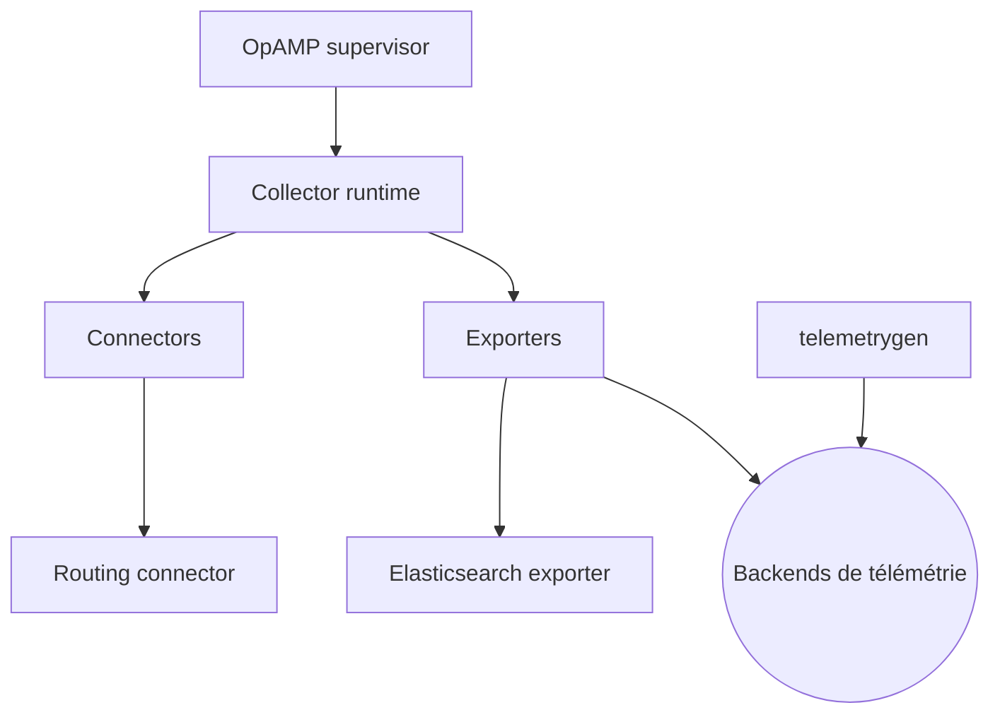

# open-telemetry/opentelemetry-collector-contrib

> Catalog of optional OpenTelemetry Collector components: receivers, processors, exporters, connectors.

## The problem
The base collector does not cover every telemetry format and destination that teams need.

## What it actually does
The repo gathers the components judged outside the core: connectors (failover, routing, span metrics, service graph), exporters (Alertmanager, Elasticsearch, file, clouds), processors such as tail sampling, storage extensions, configuration providers (S3, AES), an OpAMP supervisor and the `telemetrygen` generator. Each component has a stability level per signal (traces, metrics, logs).

## How it is wired

## Trying it
No command documented in the README: the official distributions come from the opentelemetry-collector-releases repo, or from a custom build with the Collector Builder.

## Cost and gotchas
Free, but it is not an application: you need a distribution or have to build one. Stability varies per component and per signal, and the repo has more than 1,000 open issues.

## What it is not
Not a storage backend nor a visualization tool. Not a single ready-to-run executable.

## Alternatives
No alternative cited in the README.

## For you
Adopt as the observability foundation for your inference services and pipelines: the standard of the field, backed by many companies.
