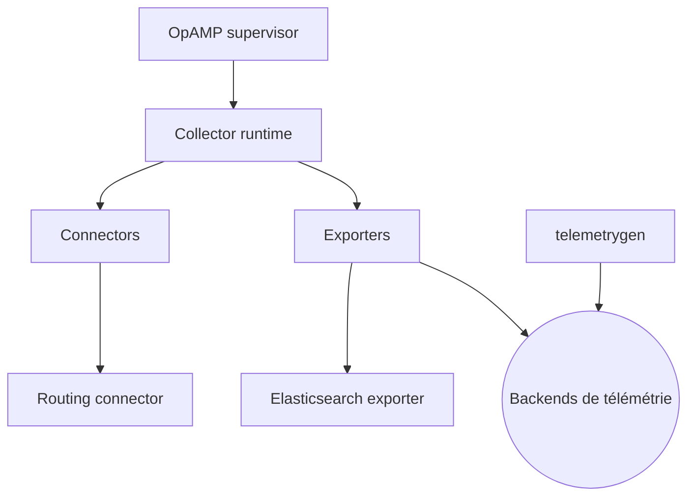

# open-telemetry/opentelemetry-collector-contrib

> Catalogue de composants optionnels du Collector OpenTelemetry : récepteurs, processeurs, exporteurs, connecteurs.

## Le problème
Le collecteur de base ne couvre pas tous les formats et destinations de télémétrie des équipes.

## Ce que ça fait vraiment
Le dépôt regroupe les composants jugés hors du cœur : connecteurs (failover, routage, span metrics, service graph), exporteurs (Alertmanager, Elasticsearch, fichier, clouds), processeurs comme le tail sampling, extensions de stockage, fournisseurs de configuration (S3, AES), un superviseur OpAMP et le générateur `telemetrygen`. Chaque composant a un niveau de stabilité par signal (traces, métriques, logs).

## Comment c'est branché

## Essayer
Aucune commande documentée dans le README : les distributions officielles viennent du dépôt opentelemetry-collector-releases, ou d'un build personnalisé avec le Collector Builder.

## Coût et pièges
Gratuit, mais ce n'est pas une application : il faut une distribution ou la construire. La stabilité varie par composant et par signal, et le dépôt compte plus de 1 000 issues ouvertes.

## Ce que ce n'est pas
Pas un backend de stockage ni un outil de visualisation. Pas un exécutable unique prêt à lancer.

## Alternatives
Aucune alternative citée dans le README.

## Pour toi
À adopter comme socle d'observabilité de tes services d'inférence et pipelines : standard du domaine, soutenu par de nombreuses entreprises.

