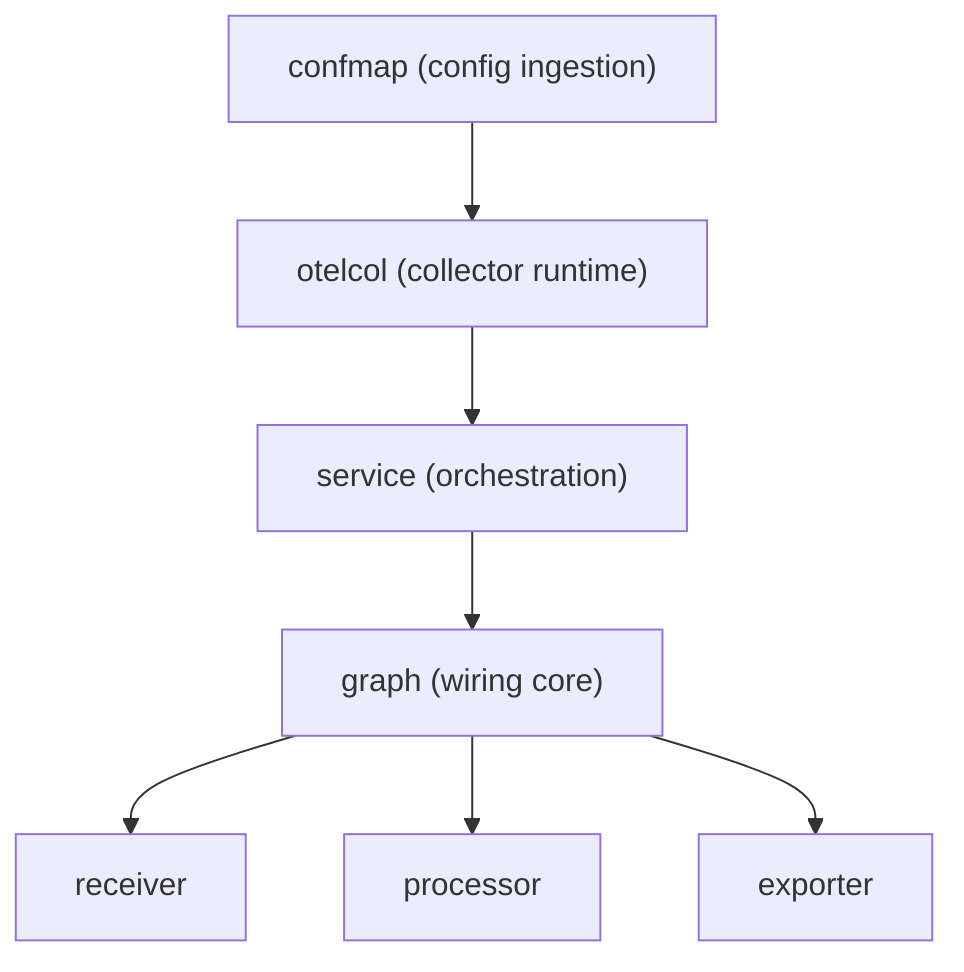

# open-telemetry/opentelemetry-collector

> Vendor-neutral collector that receives, transforms and exports traces, metrics and logs to any backend.

## The problem
Multiplying collection agents (Jaeger, Prometheus, etc.) for every telemetry format and every backend.

## What it actually does
A single binary deployable as an agent or as a collector, configured through pipelines of receivers, processors, connectors, exporters and extensions. The service assembles the graph from the configuration, and `pdata` carries the data model for logs, metrics, traces and profiles. A `builder` tool generates custom distributions from a component manifest. Images have been signed with Cosign since version 0.95.0.

## How it is wired


## Trying it
There is no collector installation command in the README; it only shows how to verify an image's signature.
```bash
cosign verify \
  --certificate-identity=https://github.com/open-telemetry/opentelemetry-collector-releases/.github/workflows/base-release.yaml@refs/tags/<RELEASE_TAG> \
  --certificate-oidc-issuer=https://token.actions.githubusercontent.com \
  <OTEL_COLLECTOR_IMAGE>
```

## Cost and gotchas
Free. The repository contains the core; the common components live in the "contrib" repository. Stability levels vary by component.

## What it is not
Not a storage backend or a dashboard: it routes telemetry. The repository is not a ready-to-use distribution but the foundation of the distributions.

## Alternatives
No alternative is named in the README.

## For you
Adopt: a must-have for cleanly instrumenting ML services or pipelines, with an open standard backed by several vendors.
