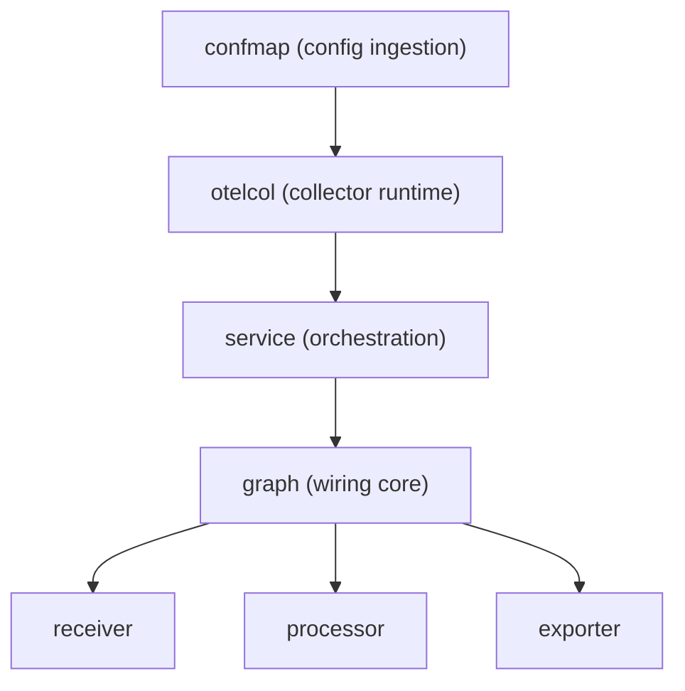

# open-telemetry/opentelemetry-collector

> Collecteur neutre qui reçoit, transforme et exporte traces, métriques et logs vers n'importe quel backend.

## Le problème
Multiplier les agents de collecte (Jaeger, Prometheus, etc.) pour chaque format de télémétrie et chaque backend.

## Ce que ça fait vraiment
Un seul binaire déployable en agent ou en collecteur, configuré par pipelines de récepteurs, processeurs, connecteurs, exportateurs et extensions. Le service assemble le graphe à partir de la configuration, et `pdata` porte le modèle de données de logs, métriques, traces et profils. Un outil `builder` génère des distributions sur mesure à partir d'un manifeste de composants. Les images sont signées avec Cosign depuis la version 0.95.0.

## Comment c'est branché


## Essayer
Aucune commande d'installation du collecteur dans le README ; il montre seulement la vérification de signature d'une image.
```bash
cosign verify \
  --certificate-identity=https://github.com/open-telemetry/opentelemetry-collector-releases/.github/workflows/base-release.yaml@refs/tags/<RELEASE_TAG> \
  --certificate-oidc-issuer=https://token.actions.githubusercontent.com \
  <OTEL_COLLECTOR_IMAGE>
```

## Coût et pièges
Gratuit. Le dépôt contient le cœur ; les composants courants vivent dans le dépôt « contrib ». Niveaux de stabilité variables selon les composants.

## Ce que ce n'est pas
Pas un backend de stockage ni un tableau de bord : il achemine la télémétrie. Le dépôt n'est pas une distribution prête à l'emploi mais le socle des distributions.

## Alternatives
Aucune alternative nommée dans le README.

## Pour toi
À adopter : passage obligé pour instrumenter proprement des services ML ou des pipelines, avec un standard ouvert soutenu par plusieurs éditeurs.

