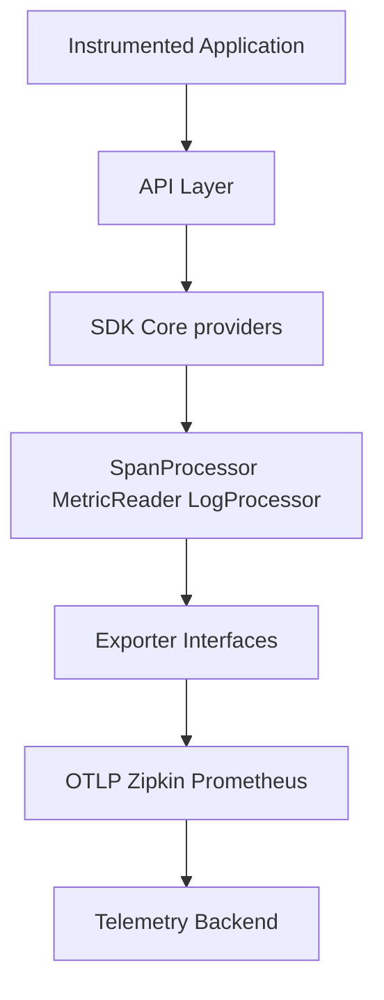

# open-telemetry/opentelemetry-cpp

> Official C++ OpenTelemetry client for tracing, measuring and logging applications.

## The problem
A C++ application needs a common API to emit traces, metrics and logs to any backend.

## What it actually does
A header-only API, an SDK (providers, samplers, processors, readers) and exporters: OTLP gRPC and HTTP, Zipkin, Prometheus, ostream, in-memory, Elasticsearch, ETW. An OpenTracing compatibility layer. Stable status for all three signals.

## How it is wired


## Trying it
No commands in the README, which points to INSTALL.md. For Bazel, add to `MODULE.bazel`:
```python
bazel_dep(name = "opentelemetry-cpp", version = "x.y.z")
```

## Cost and gotchas
Free. You must compile it (CMake or Bazel) and manage the dependencies listed in Dependencies.md. The OTLP transport goes through gRPC or through HTTP via curl.

## What it is not
Not a backend: it sends telemetry elsewhere. Not automatic instrumentation: you instrument your own code.

## Alternatives
No alternative named in the README.

## For you
Ignore unless you have C++ code to instrument: in Python, you would use the OpenTelemetry SDK for your language instead.
