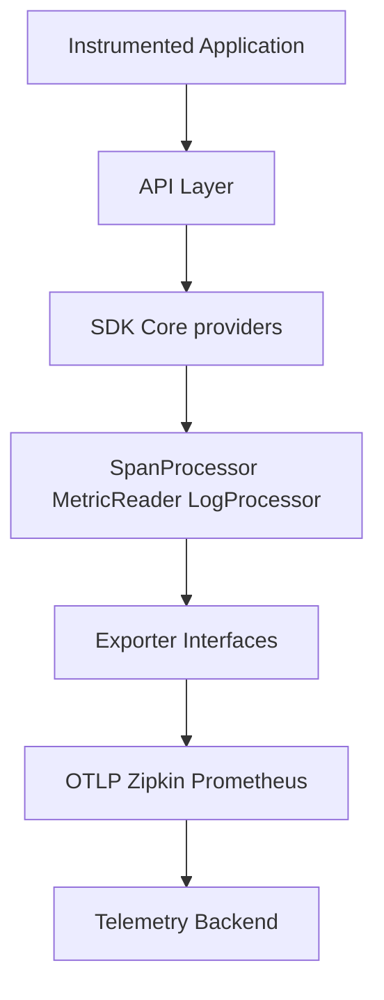

# open-telemetry/opentelemetry-cpp

> Client C++ officiel d'OpenTelemetry pour tracer, mesurer et journaliser des applications.

## Le problème
Une application C++ a besoin d'une API commune pour émettre traces, métriques et logs vers n'importe quel backend.

## Ce que ça fait vraiment
Une API en en-têtes seuls, un SDK (providers, échantillonneurs, processeurs, lecteurs) et des exporteurs : OTLP gRPC et HTTP, Zipkin, Prometheus, ostream, mémoire, Elasticsearch, ETW. Une couche de compatibilité OpenTracing. Statut stable pour les trois signaux.

## Comment c'est branché


## Essayer
Aucune commande dans le README, qui renvoie à INSTALL.md. Pour Bazel, ajouter dans `MODULE.bazel` :
```python
bazel_dep(name = "opentelemetry-cpp", version = "x.y.z")
```

## Coût et pièges
Gratuit. Il faut compiler (CMake ou Bazel) et gérer les dépendances listées dans Dependencies.md. Le transport OTLP passe par gRPC ou par HTTP via curl.

## Ce que ce n'est pas
Pas un backend : il envoie la télémétrie ailleurs. Pas une instrumentation automatique : on instrumente son code.

## Alternatives
Aucune alternative nommée dans le README.

## Pour toi
À ignorer sauf si tu as du code C++ à instrumenter : en Python, tu utiliseras plutôt le SDK OpenTelemetry de ton langage.

