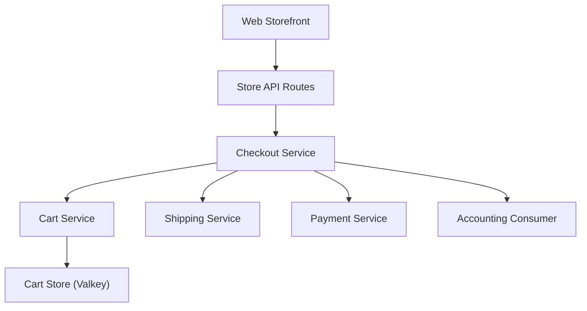

# open-telemetry/opentelemetry-demo

> Complete microservices shop for seeing OpenTelemetry instrument a realistic distributed system.

## The problem
It is hard to see what OpenTelemetry gives on a real multi-language system without building one yourself.

## What it actually does
The Astronomy Shop is a microservices store in several languages: cart (.cs), payment (charge.js), checkout (Go), currency (C++), ads (Java), fraud detection (Kotlin), email (Ruby). It also includes an AI agent, a chatbot and an MCP server. It serves as a base for observability vendors.

## How it is wired

Several links are dotted, not verified in the sampled code.

## Trying it
The README gives no command: it points to the Docker and Kubernetes guides in the documentation.

## Cost and gotchas
Free, but it launches many services: plan for RAM and a cluster for Kubernetes. The AI agent and the chatbot depend on a language model.

## What it is not
Not an application to deploy in production: it is a demonstration. The vendor demos listed are forks.

## Alternatives
No alternative named in the README (vendor forks such as Grafana Labs, Datadog or Honeycomb.io are variants of it).

## For you
Adopt: an ideal sandbox to learn instrumentation and test an observability chain, including a traced AI agent.
