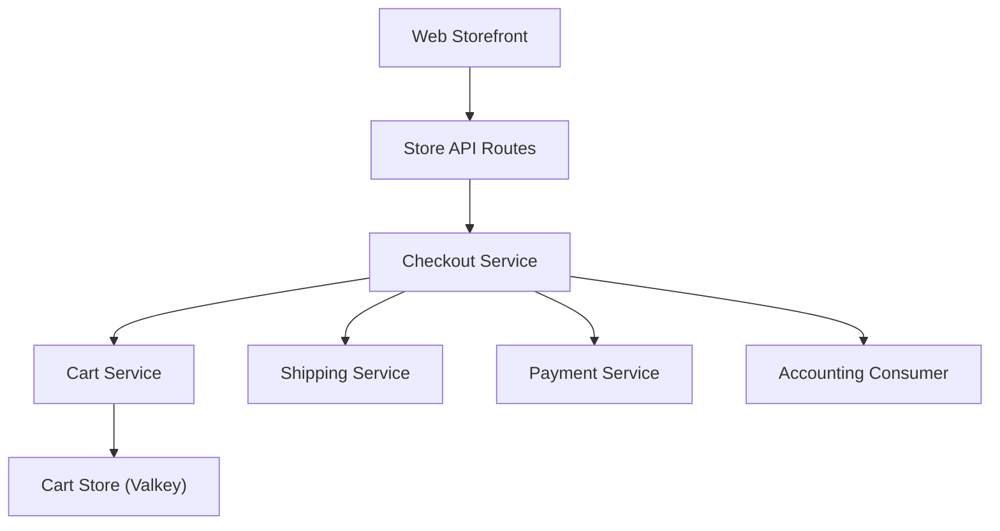

# open-telemetry/opentelemetry-demo

> Boutique de microservices complète pour voir OpenTelemetry instrumenter un système distribué réaliste.

## Le problème
Difficile de voir ce que donne OpenTelemetry sur un vrai système multi-langages sans en monter un soi-même.

## Ce que ça fait vraiment
L'Astronomy Shop est un magasin de microservices en plusieurs langages : panier (.cs), paiement (charge.js), checkout (Go), devises (C++), annonces (Java), détection de fraude (Kotlin), courriel (Ruby). Il comprend aussi un agent IA, un chatbot et un serveur MCP. Il sert de base aux éditeurs d'observabilité.

## Comment c'est branché

Plusieurs liens sont en pointillé, non vérifiés dans le code échantillonné.

## Essayer
Le README ne donne pas de commande : il renvoie aux guides Docker et Kubernetes de la documentation.

## Coût et pièges
Gratuit, mais il lance de nombreux services : prévoir de la RAM et un cluster pour Kubernetes. L'agent IA et le chatbot dépendent d'un modèle de langage.

## Ce que ce n'est pas
Pas une application à déployer en production : c'est une démonstration. Les démos d'éditeurs listées sont des forks.

## Alternatives
Aucune alternative nommée dans le README (les forks d'éditeurs comme Grafana Labs, Datadog ou Honeycomb.io en sont des variantes).

## Pour toi
À adopter : bac à sable idéal pour apprendre l'instrumentation et tester une chaîne d'observabilité, y compris un agent IA tracé.

