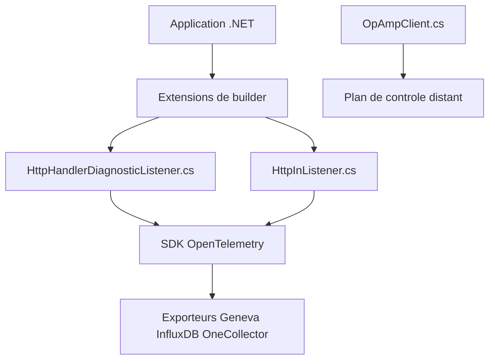

# open-telemetry/opentelemetry-dotnet-contrib

> Collection of OpenTelemetry NuGet packages for .NET: instrumentations, exporters, resource detectors and samplers.

## The problem
The OpenTelemetry .NET SDK does not cover everything: instrumentations and exporters for AWS, Kafka, SQL or Geneva are missing.

## What it actually does
Publishes independent packages, each with its own maturity level (alpha, beta, stable). Instruments HTTP, ASP.NET Core and SQL through DiagnosticSource listeners. Adds exporters (Geneva, OneCollector, InfluxDB), cloud detectors, an OpAmp client and persistent storage. The DLLs are signed with Sigstore.

## How it is wired


## Trying it
```bash
gh attestation verify --owner open-telemetry .\OpenTelemetry.Instrumentation.Http.dll
```
The README documents no installation: the packages are taken from NuGet, and this command is used to verify a DLL's attestation.

## Cost and gotchas
Free. Each component has its own maturity: read the package's `README.md` before use. Alpha and beta packages may change without compatibility.

## What it is not
Not an application nor a telemetry collector. Concerns only the .NET ecosystem.

## Alternatives
- OpenTelemetry .NET: the base SDK, for what is not in this repository.
- OpenTelemetry .NET Automatic Instrumentation: instrumentation without changing the code.

## For you
Ignore unless you instrument .NET services: OpenTelemetry observability is useful in MLOps, but this repository only covers .NET.
