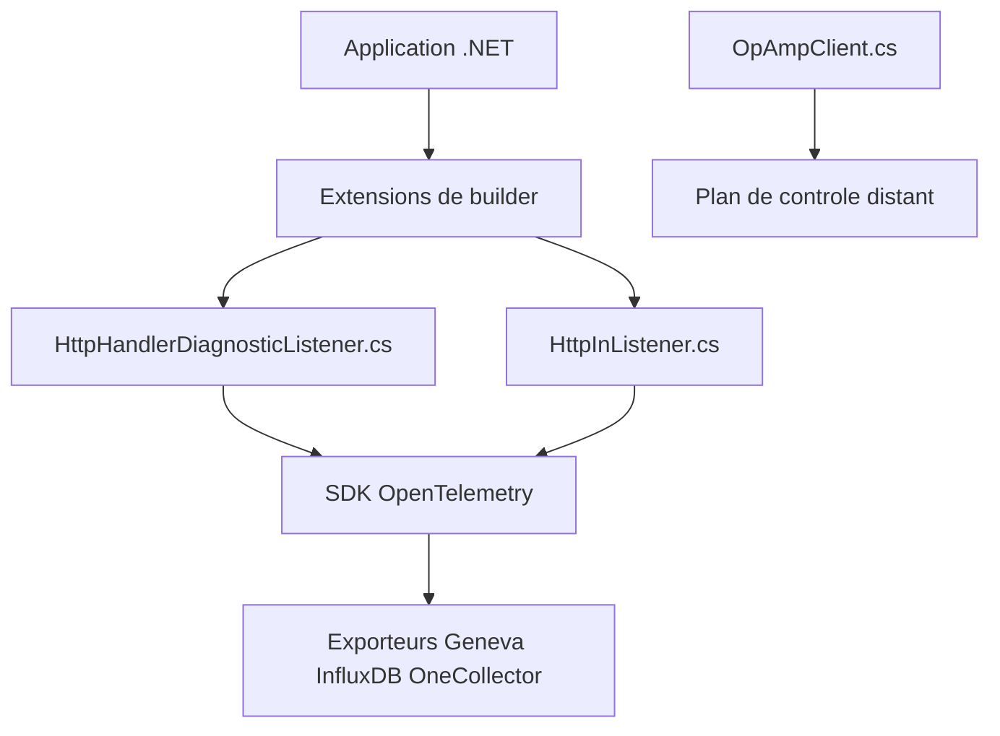

# open-telemetry/opentelemetry-dotnet-contrib

> Collection de paquets NuGet OpenTelemetry pour .NET : instrumentations, exporteurs, détecteurs de ressources et échantillonneurs.

## Le problème
Le SDK OpenTelemetry .NET ne couvre pas tout : il manque des instrumentations et exporteurs pour AWS, Kafka, SQL ou Geneva.

## Ce que ça fait vraiment
Publie des paquets indépendants, chacun avec son niveau de maturité (alpha, bêta, stable). Instrumente HTTP, ASP.NET Core et SQL via les écouteurs DiagnosticSource. Ajoute des exporteurs (Geneva, OneCollector, InfluxDB), des détecteurs cloud, un client OpAmp et du stockage persistant. Les DLL sont signées avec Sigstore.

## Comment c'est branché


## Essayer
```bash
gh attestation verify --owner open-telemetry .\OpenTelemetry.Instrumentation.Http.dll
```
Le README ne documente pas d'installation : les paquets se prennent sur NuGet, et cette commande sert à vérifier l'attestation d'une DLL.

## Coût et pièges
Gratuit. Chaque composant a sa propre maturité : lire le `README.md` du paquet avant usage. Les paquets alpha et bêta peuvent changer sans compatibilité.

## Ce que ce n'est pas
Pas une application ni un collecteur de télémétrie. Concerne uniquement l'écosystème .NET.

## Alternatives
- OpenTelemetry .NET : le SDK de base, pour ce qui n'est pas dans ce dépôt.
- OpenTelemetry .NET Automatic Instrumentation : instrumentation sans changer le code.

## Pour toi
À ignorer sauf si tu instrumentes des services .NET : l'observabilité OpenTelemetry est utile en MLOps, mais ce dépôt ne couvre que .NET.

