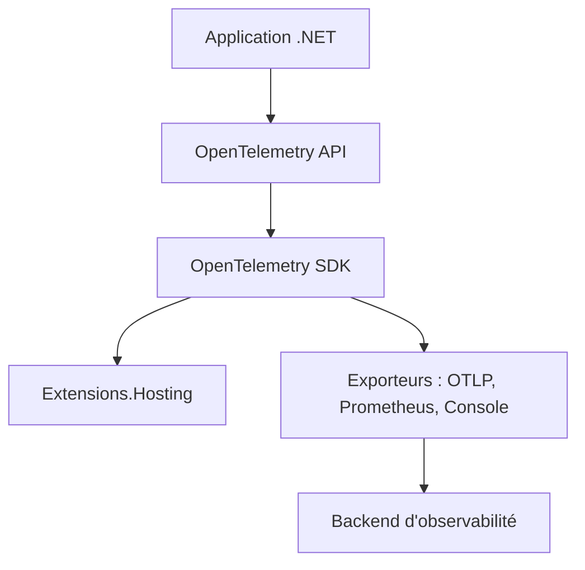

# open-telemetry/opentelemetry-dotnet

> .NET implementation of OpenTelemetry (logs, metrics, traces) for .NET application developers.

## The problem
Without a common standard, each .NET application instruments traces and metrics its own way, with incompatible formats.

## What it actually does
Provides the OpenTelemetry API and SDK for .NET, published as NuGet packages. The three signals (logs, metrics, traces) are declared stable. Exporters: Console, in-memory, OTLP, Prometheus (AspNetCore and HttpListener), Zipkin (deprecated). Published DLLs are signed with Sigstore and attested.

## How it is wired
Simplified diagram based on the sheet, no diagram supplied.



## Trying it
```bash
TAG="core-1.16.0"
cosign verify-blob \
    --bundle OpenTelemetry.dll.sigstore.json \
    --certificate-identity "https://github.com/open-telemetry/opentelemetry-dotnet/.github/workflows/publish-packages-1.0.yml@refs/tags/$TAG" \
    --certificate-oidc-issuer "https://token.actions.githubusercontent.com" \
    --use-signed-timestamps \
    OpenTelemetry.dll
```
This is the only command in the README (signature verification); installation goes through the NuGet guides.

## Cost and gotchas
Free. Some pre-release components may change without notice; instrumentations live in another repository (opentelemetry-dotnet-contrib).

## What it is not
Not a storage backend nor a dashboard: it produces and exports telemetry. It only covers .NET.

## Alternatives
- opentelemetry-dotnet-contrib: additional instrumentations, exporters and detectors.

## For you
Ignore unless you have .NET services: the standard is solid, but your data, AI and MLOps profile will mostly use it through other languages.
