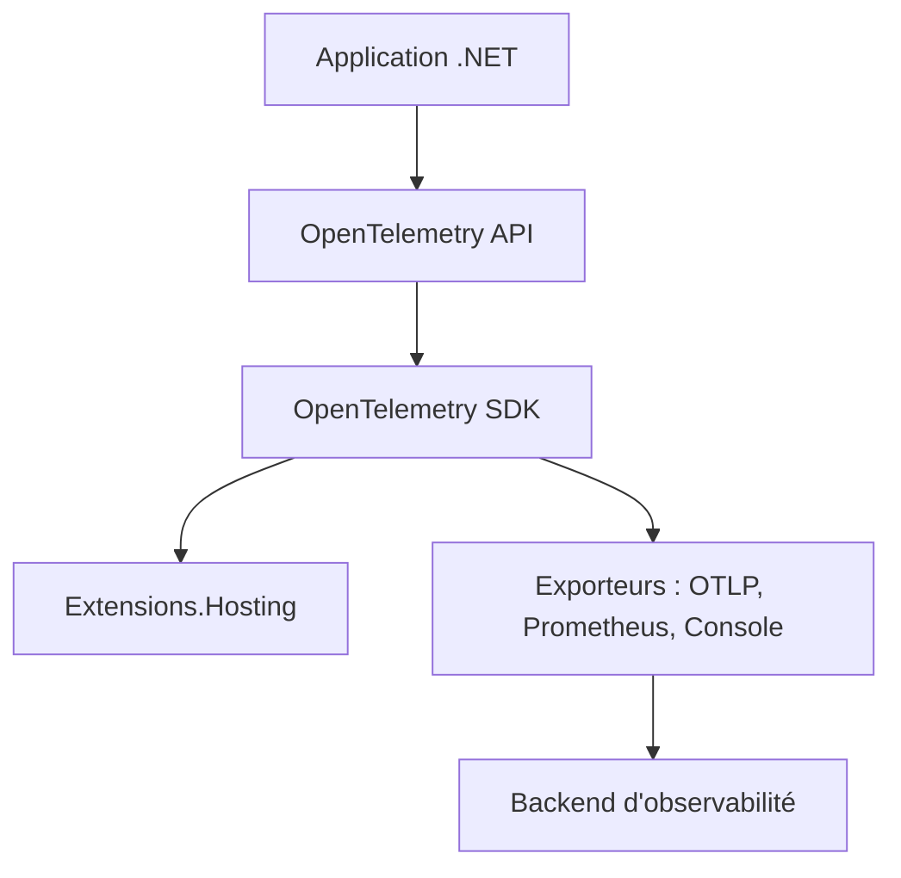

# open-telemetry/opentelemetry-dotnet

> Implémentation .NET d'OpenTelemetry (logs, métriques, traces) pour développeurs d'applications .NET.

## Le problème
Sans standard commun, chaque application .NET instrumente à sa façon traces et métriques, avec des formats incompatibles.

## Ce que ça fait vraiment
Fournit l'API et le SDK OpenTelemetry pour .NET, publiés en paquets NuGet. Les trois signaux (logs, métriques, traces) sont déclarés stables. Exporteurs : Console, mémoire, OTLP, Prometheus (AspNetCore et HttpListener), Zipkin (déprécié). Les DLL publiées sont signées avec Sigstore et attestées.

## Comment c'est branché
Schéma simplifié d'après la fiche, sans diagramme fourni.



## Essayer
```bash
TAG="core-1.16.0"
cosign verify-blob \
    --bundle OpenTelemetry.dll.sigstore.json \
    --certificate-identity "https://github.com/open-telemetry/opentelemetry-dotnet/.github/workflows/publish-packages-1.0.yml@refs/tags/$TAG" \
    --certificate-oidc-issuer "https://token.actions.githubusercontent.com" \
    --use-signed-timestamps \
    OpenTelemetry.dll
```
C'est la seule commande du README (vérification de signature) ; l'installation se fait via les guides NuGet.

## Coût et pièges
Gratuit. Certains composants pré-version peuvent changer sans préavis ; les instrumentations vivent dans un autre dépôt (opentelemetry-dotnet-contrib).

## Ce que ce n'est pas
Pas un backend de stockage ni un tableau de bord : il produit et exporte la télémétrie. Il ne couvre que .NET.

## Alternatives
- opentelemetry-dotnet-contrib : instrumentations, exporteurs et détecteurs supplémentaires.

## Pour toi
À ignorer sauf si tu as des services en .NET : le standard est solide, mais ton profil data, IA et MLOps l'utilisera surtout via d'autres langages.

