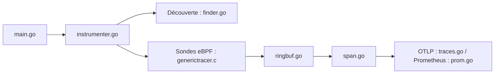

# open-telemetry/opentelemetry-ebpf-instrumentation

> eBPF agent that instruments Linux applications without code changes and exports OpenTelemetry traces and metrics.

## The problem
Instrumenting every service by hand to get traces is slow and uneven across languages.

## What it actually does
Discovers processes, attaches eBPF probes (sockets, TLS, HTTP, gRPC, databases, GPU) and injects a Java or Node agent if needed. Events are decoded into spans and metrics, then exported as OTLP or Prometheus. Side pipelines for network flows and TCP statistics.

## How it is wired


## Trying it
```bash
export VERSION=0.11.0
wget "${BASE_URL}/${ARTIFACT}"
tar -xzf obi-v${VERSION}-linux-${ARCH}.tar.gz
sudo cp obi /usr/local/bin/
obi --version
docker run --privileged otel/ebpf-instrument:${VERSION}
```

## Cost and gotchas
Linux only (amd64, arm64), elevated privileges required (`--privileged`). Pin a semver version. The v1 configuration is frozen, v2 needs migrating to. 306 open issues.

## What it is not
It is not a Windows or macOS tool. It is not a storage backend: it only emits telemetry.

## Alternatives
No alternative named in the README.

## For you
Adopt: observability without modifying the code of serving or pipeline services, within the foundation-backed OpenTelemetry ecosystem.
