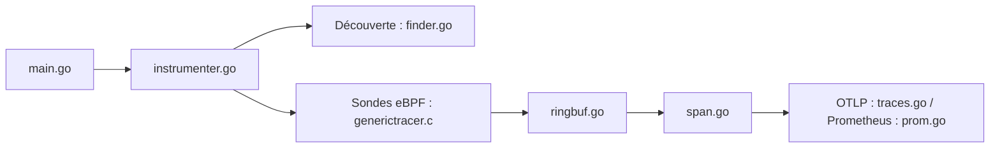

# open-telemetry/opentelemetry-ebpf-instrumentation

> Agent eBPF qui instrumente sans code les applications Linux et exporte des traces et métriques OpenTelemetry.

## Le problème
Instrumenter chaque service à la main pour obtenir des traces est long et inégal selon les langages.

## Ce que ça fait vraiment
Découvre les processus, attache des sondes eBPF (sockets, TLS, HTTP, gRPC, bases, GPU) et injecte un agent Java ou Node si besoin. Les évènements sont décodés en spans et métriques, puis exportés en OTLP ou Prometheus. Pipelines annexes pour les flux réseau et les statistiques TCP.

## Comment c'est branché


## Essayer
```bash
export VERSION=0.11.0
wget "${BASE_URL}/${ARTIFACT}"
tar -xzf obi-v${VERSION}-linux-${ARCH}.tar.gz
sudo cp obi /usr/local/bin/
obi --version
docker run --privileged otel/ebpf-instrument:${VERSION}
```

## Coût et pièges
Linux uniquement (amd64, arm64), privilèges élevés requis (`--privileged`). Épingler une version semver. La configuration v1 est figée, la v2 est à migrer. 306 issues ouvertes.

## Ce que ce n'est pas
Ce n'est pas un outil Windows ou macOS. Ce n'est pas un backend de stockage : il émet seulement la télémétrie.

## Alternatives
Aucune alternative nommée dans le README.

## Pour toi
À adopter : observabilité sans modifier le code des services de serving ou de pipelines, dans l'écosystème OpenTelemetry soutenu par une fondation.

