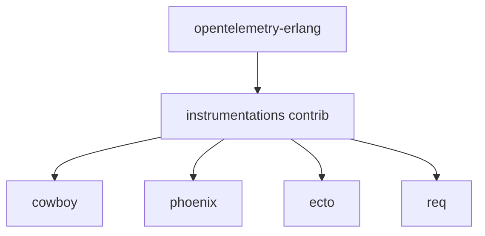

# open-telemetry/opentelemetry-erlang-contrib

> OpenTelemetry instrumentation libraries for Erlang and Elixir, outside the core API and SDK.

## The problem
Tracing Cowboy, Phoenix or Ecto requires instrumentation code that the base SDK does not provide.

## What it actually does
A contributions repository: instrumentations for opentelemetry-cowboy, opentelemetry-phoenix, opentelemetry-ecto and opentelemetry-req. The details of how it works are not in the README.

## How it is wired

## Trying it
No documented command. Add the Hex dependency you want to `mix.exs` or `rebar.config`.

## Cost and gotchas
Free. It requires the SDK from the main repository. 60 open issues.

## What it is not
Not an SDK or a collector: only library instrumentations.

## Alternatives
No alternative named in the README.

## For you
Ignore unless you trace Elixir or Erlang; outside the usual data and AI languages.
