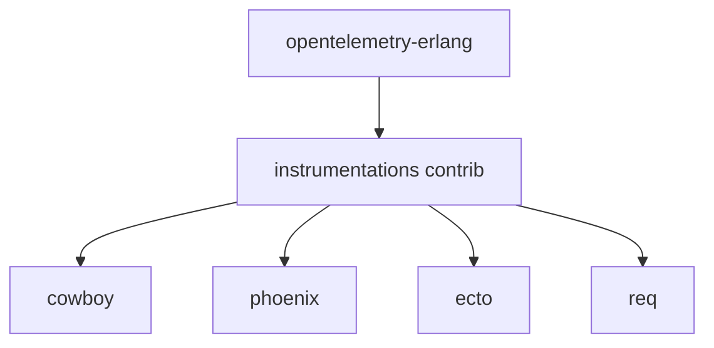

# open-telemetry/opentelemetry-erlang-contrib

> Bibliothèques d'instrumentation OpenTelemetry pour Erlang et Elixir, hors du cœur API et SDK.

## Le problème
Tracer Cowboy, Phoenix ou Ecto exige du code d'instrumentation que le SDK de base ne fournit pas.

## Ce que ça fait vraiment
Dépôt de contributions : instrumentations pour opentelemetry-cowboy, opentelemetry-phoenix, opentelemetry-ecto et opentelemetry-req. Le détail du fonctionnement n'est pas dans le README.

## Comment c'est branché

## Essayer
Aucune commande documentée. Ajouter la dépendance Hex voulue dans `mix.exs` ou `rebar.config`.

## Coût et pièges
Gratuit. Il faut le SDK du dépôt principal. 60 issues ouvertes.

## Ce que ce n'est pas
Pas un SDK ni un collecteur : uniquement des instrumentations de bibliothèques.

## Alternatives
Aucune alternative nommée dans le README.

## Pour toi
À ignorer sauf si tu traces du Elixir ou Erlang ; hors des langages courants du data et de l'IA.

