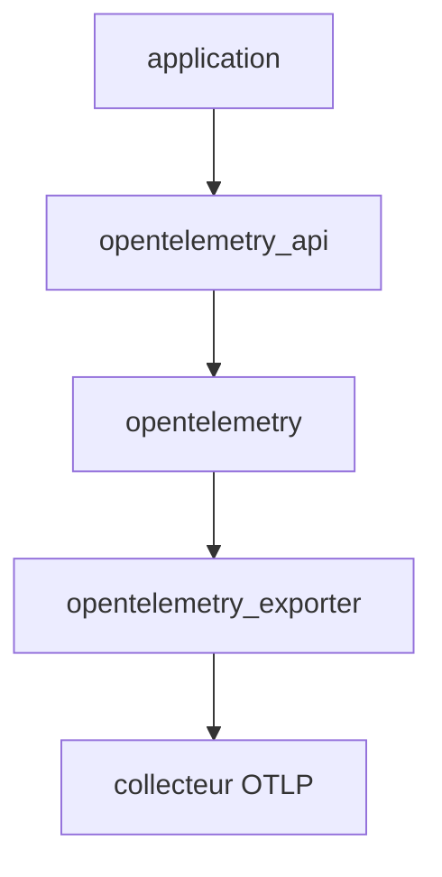

# open-telemetry/opentelemetry-erlang

> OpenTelemetry API, SDK and OTLP exporter for tracing Erlang and Elixir applications.

## The problem
BEAM applications have no standard distributed tracing compatible with the rest of the OpenTelemetry ecosystem.

## What it actually does
Three Hex packages: `opentelemetry_api` (application dependency, noop by default), `opentelemetry` (SDK) and `opentelemetry_exporter` (OTLP). Implements specification 1.8.0. The SDK goes in the OTP release, with the exporter started before it. Library instrumentation is in the contrib repository.

## How it is wired


## Trying it
```bash
rebar3 as bench shell
```
For getting started, the README points to the guide on opentelemetry.io; deps are declared in `rebar.config` or `mix.exs`.

## Cost and gotchas
Free. Erlang/OTP 23+, Elixir 1.13+. Via Git, `git_subdir` or `sparse` and `override: true` are required.

## What it is not
Not automatic instrumentation: libraries are in another repository. 156 open issues.

## Alternatives
- opentelemetry-erlang-contrib: official instrumentations (Cowboy, Phoenix, Ecto, Req).

## For you
Ignore unless you use an Elixir or Erlang stack: for Python or Go, this is not your SDK.
