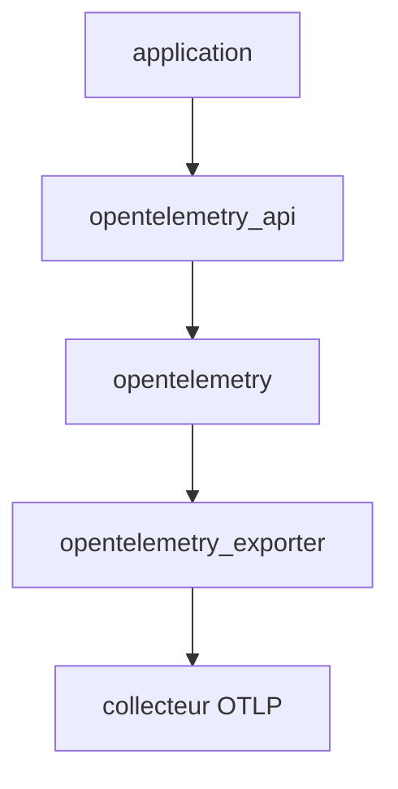

# open-telemetry/opentelemetry-erlang

> API, SDK et exportateur OTLP OpenTelemetry pour tracer des applications Erlang et Elixir.

## Le problème
Les applications BEAM n'ont pas de traçage distribué standard compatible avec le reste de l'écosystème OpenTelemetry.

## Ce que ça fait vraiment
Trois paquets Hex : `opentelemetry_api` (dépendance de l'appli, noop par défaut), `opentelemetry` (SDK) et `opentelemetry_exporter` (OTLP). Implémente la spécification 1.8.0. Le SDK se place dans la release OTP, l'exportateur démarré avant lui. L'instrumentation de bibliothèques est dans le dépôt contrib.

## Comment c'est branché


## Essayer
```bash
rebar3 as bench shell
```
Pour la prise en main, le README renvoie au guide sur opentelemetry.io ; les deps se déclarent dans `rebar.config` ou `mix.exs`.

## Coût et pièges
Gratuit. Erlang/OTP 23+, Elixir 1.13+. Via Git, `git_subdir` ou `sparse` et `override: true` sont nécessaires.

## Ce que ce n'est pas
Pas de l'instrumentation automatique : les bibliothèques sont dans un autre dépôt. 156 issues ouvertes.

## Alternatives
- opentelemetry-erlang-contrib : instrumentations officielles (Cowboy, Phoenix, Ecto, Req).

## Pour toi
À ignorer sauf stack Elixir ou Erlang : pour du Python ou du Go, ce n'est pas ton SDK.

