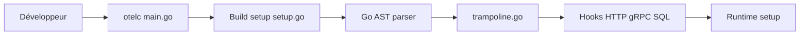

# open-telemetry/opentelemetry-go-compile-instrumentation

> Tool that injects OpenTelemetry instrumentation into Go applications at compile time, without changing the code.

## The problem
Instrumenting a Go app and its dependencies requires manual code changes.

## What it actually does
`otelc` prefixes `go build`: it analyzes the code (AST), applies rules and injects hooks via trampolines before compilation. Hooks provided for HTTP, gRPC, SQL, Redis, MongoDB, Kubernetes client-go. The README claims zero runtime overhead (with a footnote).

## How it is wired


## Trying it
```bash
git clone https://github.com/open-telemetry/opentelemetry-go-compile-instrumentation.git
cd opentelemetry-go-compile-instrumentation
make build
cd demo/app/basic
../../../otelc go build
```

## Cost and gotchas
Free; you have to build the tool. 196 open issues; you need an OTLP backend to make use of the traces.

## What it is not
Not an observability backend. Coverage limited to libraries that have a hook; the "zero overhead" claim needs nuance.

## Alternatives
No alternative cited in the README.

## For you
Watch: relevant if you serve models or services in Go; outside Go, irrelevant.
