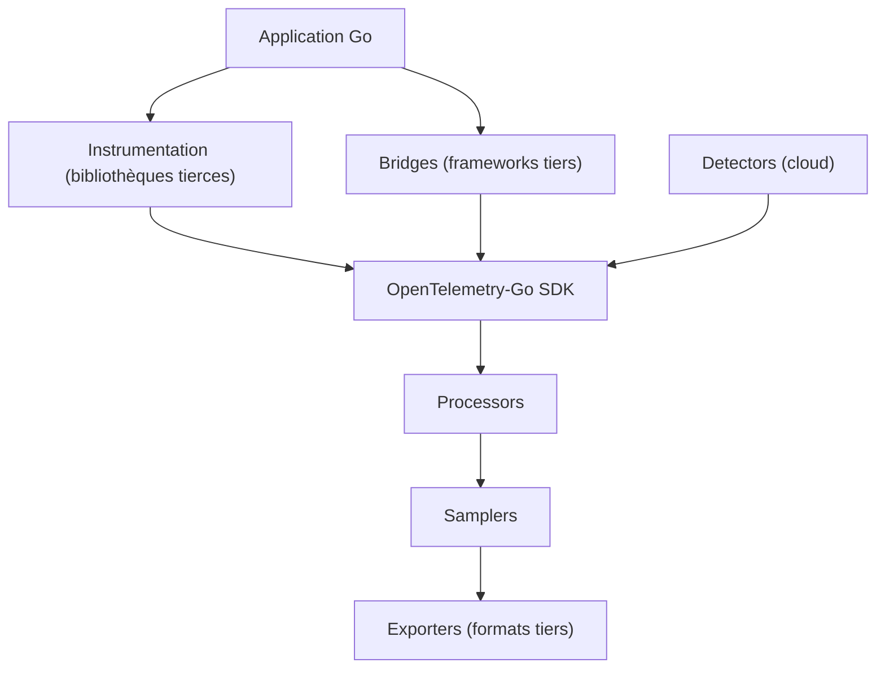

# open-telemetry/opentelemetry-go-contrib

> OpenTelemetry's repository of third-party packages for Go: instrumentations, exporters, detectors.

## The problem
The OpenTelemetry Go SDK knows nothing about your HTTP library, your cloud, or your proprietary trace format: everything else lives elsewhere.

## What it actually does
Gathers eight families of packages. The **instrumentations** cover third-party libraries; the **propagators** handle non-standard context propagation formats; the **detectors** identify resources in cloud environments; the **exporters** write to third-party formats; the **samplers** add sampling implementations; the **bridges** adapt third-party instrumentation frameworks; the **processors** complement those of the SDK. Usage examples are provided. The repository contains both stable and unstable modules: the version and stability guarantees are read module by module, via the versioning manifest.

## How it is wired

## Trying it
No documented command: the README is a table of contents, each module having its own documentation and its own version.

## Cost and gotchas
Free. The catch is stability: **the repository mixes stable and unstable modules**, and you need to check the specific module you import rather than the repository. Explicit Go compatibility policy: each major Go version is supported until two newer versions exist, one minor release adds support for a new Go, the next one drops the compatibility test with the oldest. Test matrix: Ubuntu, macOS and Windows on Go 1.26 and 1.27, amd64, 386 and arm64 depending on the case; nothing is guaranteed elsewhere.

## What it is not
It is not the OpenTelemetry-Go SDK: it is the repository of contributions around it. It is not a single module versioned globally. And it is not a product — it is a collection.

## Alternatives
- The main opentelemetry-go repository, for everything that is core and stable.

## For you
The reflex to have when your Go service needs to export traces to a non-standard backend.
