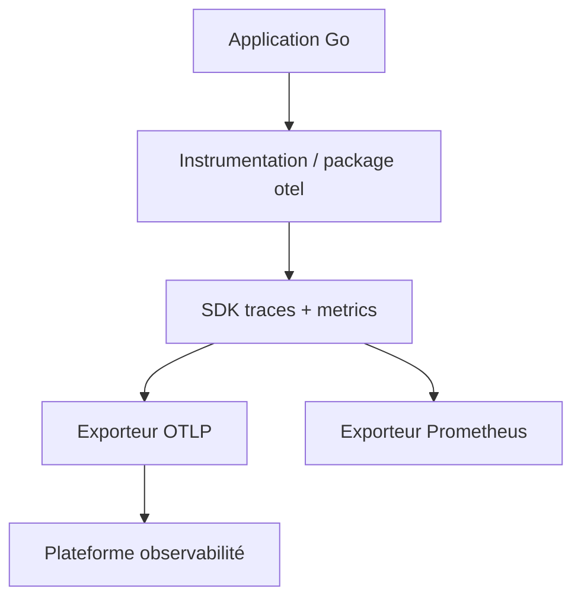

# open-telemetry/opentelemetry-go

> Go implementation of OpenTelemetry: APIs to trace and measure an application.

## The problem
Instrumenting a Go app to send traces and metrics to an observability platform requires a standard set of APIs, otherwise each backend imposes its own SDK.

## What it actually does
Provides the APIs to capture distributed traces and metrics and send them to an observability platform. Traces and Metrics are stable, Logs are in Release Candidate. Two steps: instrument (official instrumentation libraries or the `otel` package) then configure an exporter (OTLP, Prometheus, stdout, Zipkin). Compatibility aligned with supported Go versions.

## How it is wired

## Trying it
No installation command in the README excerpt (it points to the opentelemetry.io getting started and the `exporters` folder). To be written: see the getting-started guide on opentelemetry.io.

## Cost and gotchas
Free. Logs still in RC (no stability guarantee). Compatibility limited to actively supported Go versions.

## What it is not
Not an observability platform: only the application-side APIs/SDK; a backend (Prometheus, Zipkin, etc.) is needed.

## Alternatives
Not named as substitutes (the listed exporters are targets, not competitors).

## For you
Standard if you instrument Go services in your ML stack; otherwise a general infrastructure building block.
