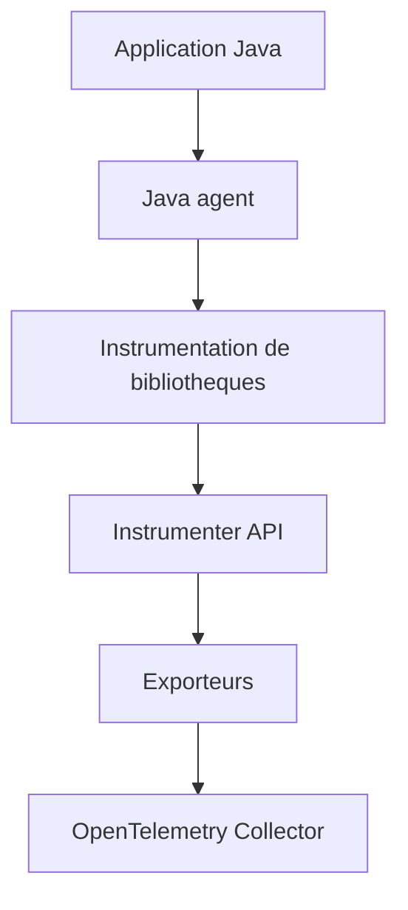

# open-telemetry/opentelemetry-java-instrumentation

> JVM agent that injects bytecode to capture traces and metrics from Java applications without modifying the code.

## The problem
Hand-instrumenting every Java library to get telemetry is slow and inconsistent.

## What it actually does
A JAR attached with `-javaagent` automatically instruments many libraries (Java 8+) and exports telemetry, by default over OTLP to a collector on `localhost:4318`. Configuration through system properties or environment variables. Agent extensions, annotations (`@WithSpan`), manual instrumentation, trace id injection into logs (MDC) and standalone libraries.

## How it is wired


## Trying it
```bash
java -javaagent:path/to/opentelemetry-javaagent.jar \
     -jar myapp.jar
java -javaagent:path/to/opentelemetry-javaagent.jar \
     -Dotel.resource.attributes=service.name=your-service-name \
     -Dotel.traces.exporter=console \
     -jar myapp.jar
```

## Cost and gotchas
Free; a collector or backend is required. The README warns that configuration parameter names change often.

## What it is not
Not an observability backend: it emits, it neither stores nor displays.

## Alternatives
No alternative named in the README.

## For you
Adopt if your inference or data services run on the JVM: standard observability, without touching the code.
