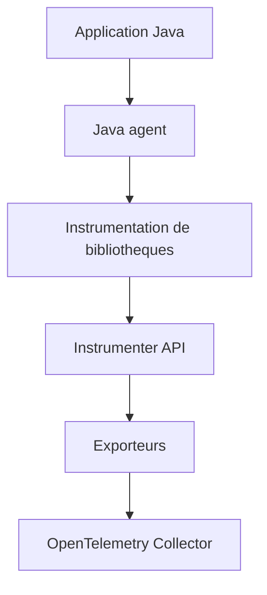

# open-telemetry/opentelemetry-java-instrumentation

> Agent JVM qui injecte du bytecode pour capter traces et métriques d'applications Java sans modifier le code.

## Le problème
Instrumenter à la main chaque bibliothèque Java pour obtenir de la télémétrie est long et incohérent.

## Ce que ça fait vraiment
Un JAR attaché par `-javaagent` instrumente automatiquement de nombreuses bibliothèques (Java 8+) et exporte la télémétrie, par défaut en OTLP vers un collecteur sur `localhost:4318`. Configuration par propriétés système ou variables d'environnement. Extensions d'agent, annotations (`@WithSpan`), instrumentation manuelle, injection d'identifiants de trace dans les logs (MDC) et bibliothèques autonomes.

## Comment c'est branché


## Essayer
```bash
java -javaagent:path/to/opentelemetry-javaagent.jar \
     -jar myapp.jar
java -javaagent:path/to/opentelemetry-javaagent.jar \
     -Dotel.resource.attributes=service.name=your-service-name \
     -Dotel.traces.exporter=console \
     -jar myapp.jar
```

## Coût et pièges
Gratuit ; un collecteur ou backend est nécessaire. Le README prévient que les noms de paramètres de configuration changent souvent.

## Ce que ce n'est pas
Pas un backend d'observabilité : il émet, il ne stocke ni n'affiche.

## Alternatives
Aucune alternative nommée dans le README.

## Pour toi
À adopter si tes services d'inférence ou de données tournent sur la JVM : observabilité standard, sans toucher au code.

