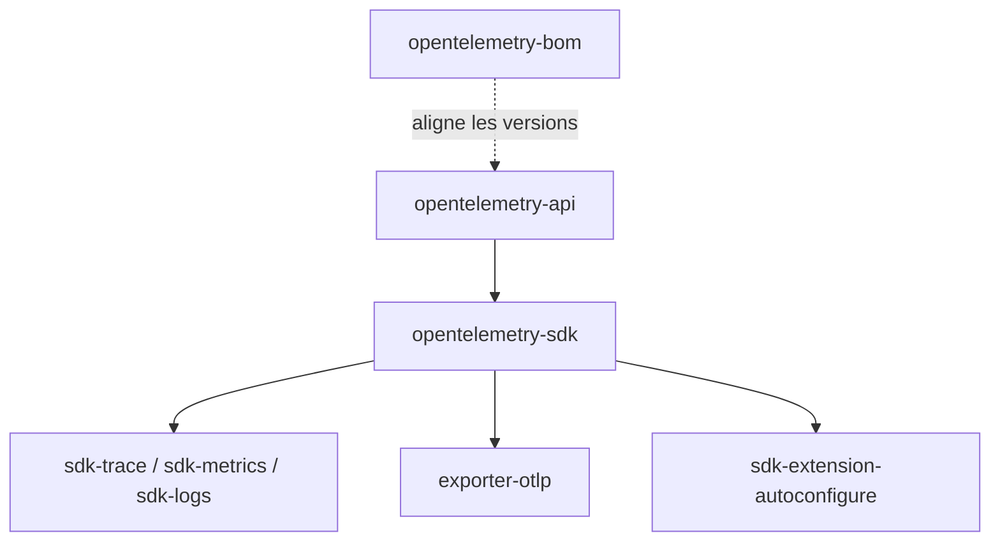

# open-telemetry/opentelemetry-java

> Java implementation of the OpenTelemetry API and SDK to produce traces, metrics and logs.

## The problem
Without a common standard, each observability tool imposes its own client and telemetry format.

## What it actually does
Publishes on Maven Central an API (traces, metrics, baggage, context), an SDK (traces, metrics, logs), exporters (OTLP, Prometheus, logging) and extensions (autoconfiguration, propagators). A bill of materials (BOM) synchronizes versions. Java 8 or later. Alpha versions for profiles.

## How it is wired


## Trying it
```bash
implementation('io.opentelemetry:{{artifact-id}}')
```
To be used with a BOM (`opentelemetry-bom`) in Gradle or Maven, as described in the README.

## Cost and gotchas
Free. Keep artifact versions aligned via the BOM, otherwise runtime errors are possible. On Android, desugaring must be enabled. `-alpha` artifacts have no compatibility guarantee.

## What it is not
Not an observability backend: it produces and exports, it neither stores nor displays. Not the Java instrumentation agent, covered elsewhere. The project is looking for contributors.

## Alternatives
No alternative named; the OpenCensus and OpenTracing shims are marked deprecated.

## For you
Keep an eye on it: useful only if your inference services or pipelines are in Java; in Python, take the corresponding SDK.
