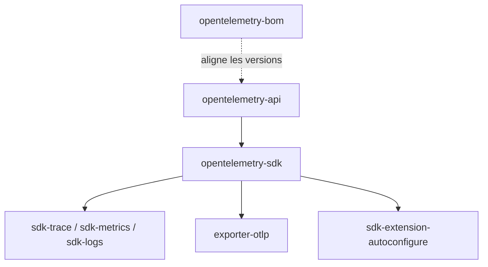

# open-telemetry/opentelemetry-java

> Implémentation Java de l'API et du SDK OpenTelemetry pour produire traces, métriques et logs.

## Le problème
Sans standard commun, chaque outil d'observabilité impose son propre client et son format de télémétrie.

## Ce que ça fait vraiment
Publie sur Maven Central une API (traces, métriques, baggage, contexte), un SDK (traces, métriques, logs), des exporteurs (OTLP, Prometheus, logging) et des extensions (autoconfiguration, propagateurs). Une nomenclature (BOM) synchronise les versions. Java 8 ou plus. Versions alpha pour les profils.

## Comment c'est branché


## Essayer
```bash
implementation('io.opentelemetry:{{artifact-id}}')
```
À utiliser avec une BOM (`opentelemetry-bom`) en Gradle ou Maven, comme décrit dans le README.

## Coût et pièges
Gratuit. Garder les versions des artefacts alignées via la BOM, sinon erreurs d'exécution possibles. Sous Android, le desugaring doit être activé. Les artefacts `-alpha` n'ont pas de garantie de compatibilité.

## Ce que ce n'est pas
Pas un backend d'observabilité : il produit et exporte, il ne stocke ni n'affiche. Pas l'agent Java d'instrumentation, traité ailleurs. Le projet cherche des contributeurs.

## Alternatives
Aucune alternative nommée ; les shims OpenCensus et OpenTracing sont marqués dépréciés.

## Pour toi
À surveiller : utile seulement si tes services d'inférence ou pipelines sont en Java ; en Python, prends le SDK correspondant.

