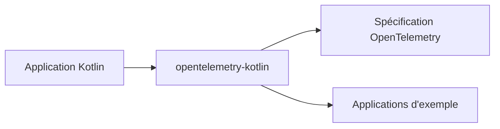

# open-telemetry/opentelemetry-kotlin

> Implementation of the OpenTelemetry specification in Kotlin Multiplatform, for Kotlin application developers.

## The problem
Without this library, instrumenting a multiplatform Kotlin app with OpenTelemetry means going through platform-specific SDKs.

## What it actually does
Provides an implementation of the OpenTelemetry specification as a Kotlin Multiplatform library. The README details nothing else: it points to documentation and sample applications. The maintainers come from Embrace and Splunk.

## How it is wired
Simplified diagram based on the sheet, no diagram provided.

## Trying it
No command documented in the README: it points to the online documentation.

## Cost and gotchas
Free, no key mentioned. The real requirement is a Kotlin project (JVM or multiplatform), absent from the prerequisites list. The repository was created in January 2026: young.

## What it is not
Neither a collector nor an observability backend: only the application-side instrumentation layer. The README gives no installation command.

## Alternatives
No alternative named in the README.

## For you
Worth watching: useful only if you instrument multiplatform Kotlin, outside the usual data / AI scope.
