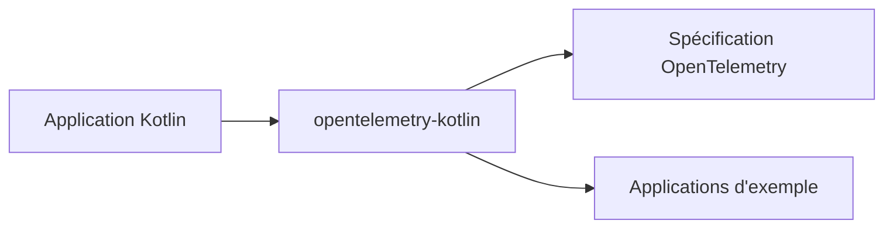

# open-telemetry/opentelemetry-kotlin

> Implémentation de la spécification OpenTelemetry en Kotlin Multiplatform, pour les développeurs d'applications Kotlin.

## Le problème
Sans cette bibliothèque, instrumenter une appli Kotlin multiplateforme avec OpenTelemetry oblige à passer par des SDK propres à chaque plateforme.

## Ce que ça fait vraiment
Fournit une implémentation de la spécification OpenTelemetry sous forme de bibliothèque Kotlin Multiplatform. Le README ne détaille rien d'autre : il renvoie à une documentation et à des applications d'exemple. Les mainteneurs viennent d'Embrace et de Splunk.

## Comment c'est branché
Schéma simplifié d'après la fiche, sans diagramme fourni.

## Essayer
Aucune commande documentée dans le README : il renvoie à la documentation en ligne.

## Coût et pièges
Gratuit, aucune clé citée. Le besoin réel est un projet Kotlin (JVM ou multiplateforme), absent de la liste des prérequis. Le dépôt a été créé en janvier 2026 : jeune.

## Ce que ce n'est pas
Ni un collecteur ni un backend d'observabilité : seulement la couche d'instrumentation côté application. Le README ne donne aucune commande d'installation.

## Alternatives
Aucune alternative nommée dans le README.

## Pour toi
À surveiller : utile seulement si tu instrumentes du Kotlin multiplateforme, hors du périmètre habituel data / IA.

