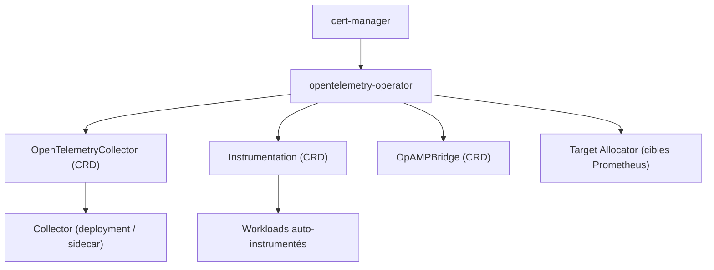

# open-telemetry/opentelemetry-operator

> Kubernetes operator that manages OpenTelemetry collectors and automatic instrumentation.

## The problem
Deploying one OpenTelemetry collector per cluster and instrumenting every application by hand
makes configurations drift apart as fast as they are written.

## What it actually does
Manages two things: the deployment of the **OpenTelemetry Collector** via the `OpenTelemetryCollector`
CRD (several deployment modes, sidecar injection, observability), and the **auto-instrumentation**
of workloads via the `Instrumentation` CRD (per-language injection, resource attributes). Two
additional components are documented: the Target Allocator, which distributes and discovers
Prometheus scrape targets, and the OpAMP Bridge with its `OpAMPBridge` CRD. User documentation
lives under `docs/`: getting started, concepts, task-oriented use cases, troubleshooting, API
reference, CRD changelog, feature gates, and RFCs for design proposals.

## How it is wired


## Trying it
```bash
kubectl apply -f https://github.com/open-telemetry/opentelemetry-operator/releases/latest/download/opentelemetry-operator.yaml
```

## Cost and gotchas
Free. Explicit prerequisite: `cert-manager` must be installed in the cluster before the operator.
Installation via Helm is possible from the opentelemetry-helm-charts repository. The README says
nothing about the resources the collector consumes nor the cost of the observability backend
behind it — that is where the bill arrives.

## What it is not
It is not an observability backend: it deploys collectors, it stores and displays nothing. It is
not the Collector itself. And auto-instrumentation depends on the per-language OpenTelemetry
instrumentation libraries, not on the operator.

## Alternatives
- The opentelemetry-helm-charts Helm chart, another way of installing the same operator.

## For you
The standard building block for instrumenting your ML services in a cluster without manual configuration.
