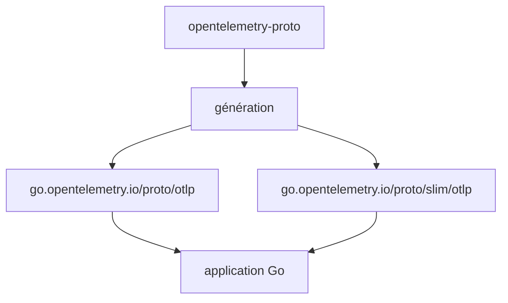

# open-telemetry/opentelemetry-proto-go

> Go code generated from the OTLP protobuf definitions, to send or receive telemetry.

## The problem
Writing OTLP's structures and gRPC clients by hand in Go is long and error-prone.

## What it actually does
Generated Go modules for trace, metrics, logs and common types, versioned according to semantic import versioning. A `slim/otlp` module provides the messages without gRPC, for HTTP clients, with a distinct namespace so it can coexist with the canonical module. The `development` packages do not follow semver.

## How it is wired


## Trying it
```bash
go get go.opentelemetry.io/proto/otlp@latest
go get go.opentelemetry.io/proto/slim/otlp@latest
```

## Cost and gotchas
Free. Switching to `slim` changes the full protobuf names: watch out for reflection, the registry and `Any` types. Tested on Ubuntu with Go 1.26 and 1.27.

## What it is not
Not an instrumentation SDK: only the generated types and clients.

## Alternatives
No alternative named in the README.

## For you
Worth watching: only useful if you write a collector or exporter in Go; otherwise use the OpenTelemetry SDK for your language.
