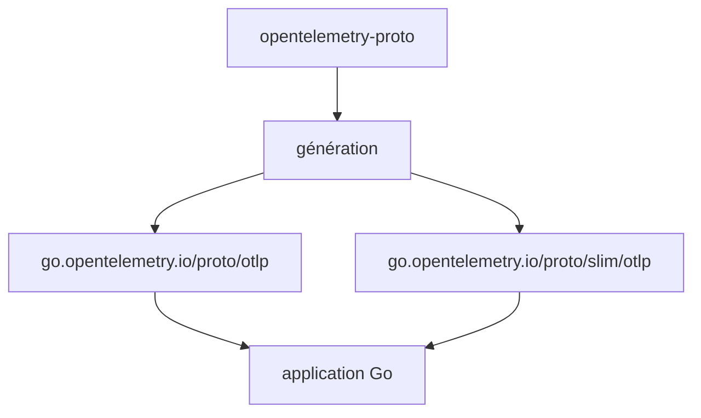

# open-telemetry/opentelemetry-proto-go

> Code Go généré à partir des définitions protobuf OTLP, pour envoyer ou recevoir de la télémétrie.

## Le problème
Écrire à la main les structures et clients gRPC d'OTLP en Go est long et sujet aux erreurs.

## Ce que ça fait vraiment
Modules Go générés pour trace, métriques, logs et types communs, versionnés selon le semantic import versioning. Un module `slim/otlp` fournit les messages sans gRPC, pour les clients HTTP, avec un espace de noms distinct pour coexister avec le module canonique. Les paquets `development` ne suivent pas semver.

## Comment c'est branché


## Essayer
```bash
go get go.opentelemetry.io/proto/otlp@latest
go get go.opentelemetry.io/proto/slim/otlp@latest
```

## Coût et pièges
Gratuit. Le passage à `slim` change les noms complets protobuf : attention à la réflexion, au registre et aux types `Any`. Testé sur Ubuntu avec Go 1.26 et 1.27.

## Ce que ce n'est pas
Pas un SDK d'instrumentation : seulement les types et clients générés.

## Alternatives
Aucune alternative nommée dans le README.

## Pour toi
À surveiller : utile uniquement si tu écris un collecteur ou un exportateur en Go ; sinon passe par le SDK OpenTelemetry de ton langage.

