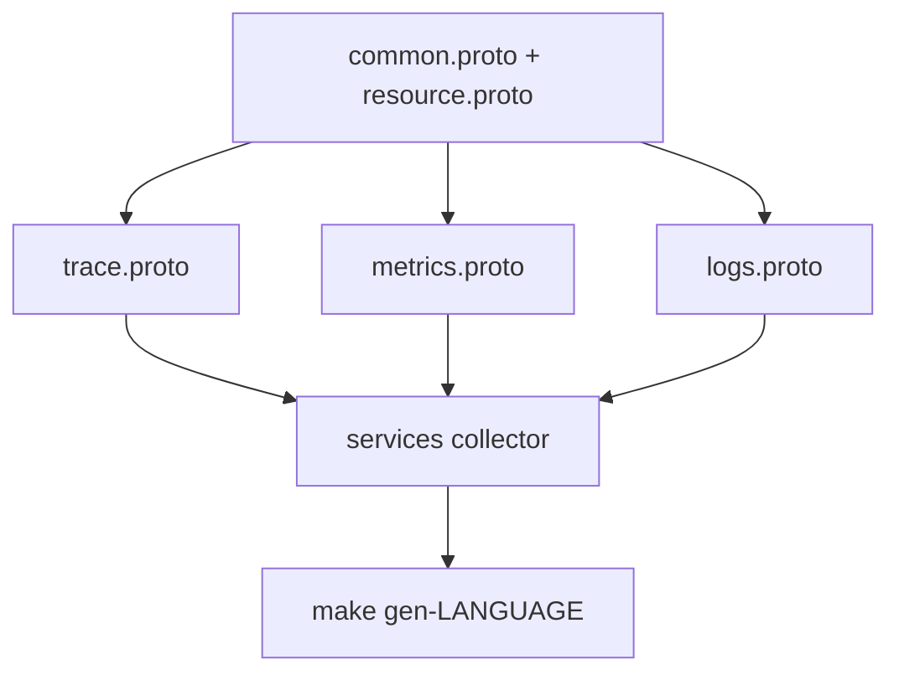

# open-telemetry/opentelemetry-proto

> Protocol Buffers definitions of OTLP, the transport protocol for OpenTelemetry traces, metrics, logs and profiles.

## The problem
Without a common schema, every exporter and collector invents its own format and observability tools cannot talk to each other.

## What it actually does
Repository of versioned `.proto` contracts, with HTTP annotations and a specification. Export services for traces, metrics, logs, and profiles under development. Shared common and resource types. A separate protocol describes process context sharing through memory mapping. `make gen-LANGUAGE` produces raw clients.

## How it is wired


## Trying it
```bash
make gen-python
```
Languages listed: cpp, csharp, go, java, objc, openapi, php, python, ruby.

## Cost and gotchas
Free. Profiles and process context are under development, hence unstable. No guarantee on the generated code.

## What it is not
Not a collector nor an SDK: only the contract. It cannot be used alone to send telemetry.

## Alternatives
No alternative named in the README.

## For you
Adopt as a reference: if you instrument ML pipelines or inference services with OpenTelemetry, this schema is the source of truth, stable for traces, metrics and logs.
