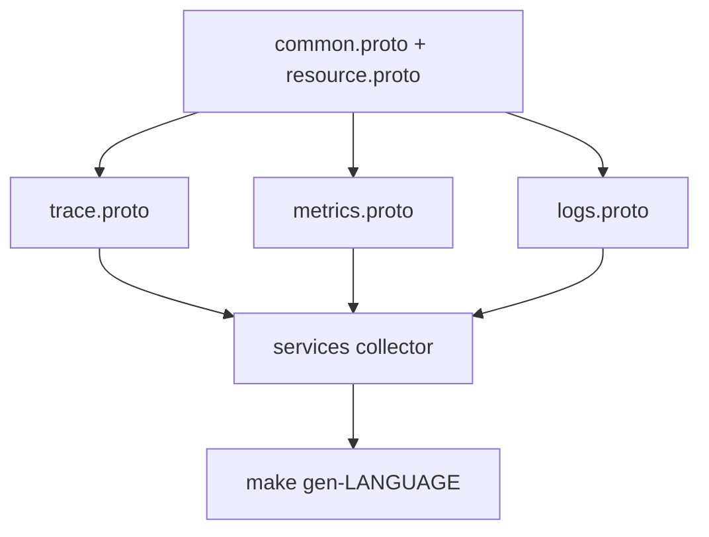

# open-telemetry/opentelemetry-proto

> Définitions Protocol Buffers d'OTLP, le protocole de transport de traces, métriques, logs et profils OpenTelemetry.

## Le problème
Sans schéma commun, chaque exportateur et collecteur invente son format et les outils d'observabilité ne se parlent pas.

## Ce que ça fait vraiment
Dépôt de contrats `.proto` versionnés, avec annotations HTTP et spécification. Services d'export pour traces, métriques, logs, et profils en développement. Types communs et ressource partagés. Un protocole séparé décrit le partage de contexte de processus par mémoire mappée. `make gen-LANGUAGE` produit des clients bruts.

## Comment c'est branché


## Essayer
```bash
make gen-python
```
Langages listés : cpp, csharp, go, java, objc, openapi, php, python, ruby.

## Coût et pièges
Gratuit. Profils et process context sont en développement, donc instables. Aucune garantie sur le code généré.

## Ce que ce n'est pas
Pas un collecteur ni un SDK : seulement le contrat. Ne s'utilise pas seul pour envoyer de la télémétrie.

## Alternatives
Aucune alternative nommée dans le README.

## Pour toi
À adopter comme référence : si tu instrumentes des pipelines ML ou des services d'inférence en OpenTelemetry, ce schéma est la source de vérité, stable pour trace, métriques et logs.

