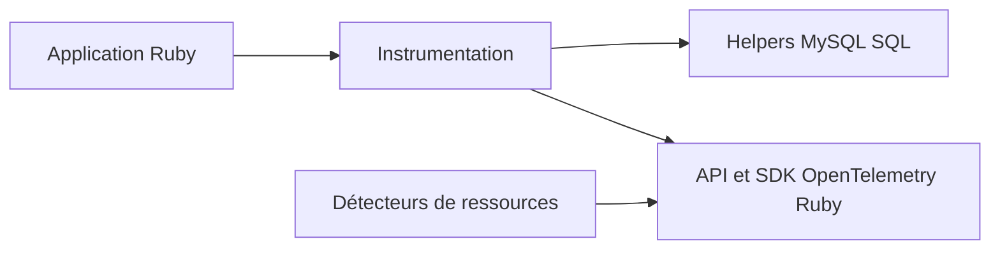

# open-telemetry/opentelemetry-ruby-contrib

> OpenTelemetry contribution packages for Ruby: instrumentation of popular gems and resource detectors.

## The problem
Instrumenting a Ruby app (Rails, Rack, Sinatra) with OpenTelemetry requires one instrumentation per library.

## What it actually does
Contains instrumentation libraries for many gems (Rails, Rack, Sinatra), shared helpers (MySQL, SQL Processor), OTTrace and Amazon X-Ray context propagation, and Azure, container and Google Cloud resource detectors. Ruby 3.3 or later required since March 31, 2026.

## How it is wired
Simplified diagram based on the sheet, no diagram provided.

## Trying it
No command documented: each gem has its own README.

## Cost and gotchas
Free. Volunteer project: end-of-life Ruby or gem versions lose support, with mandatory pinning of the old version.

## What it is not
Not a full SDK: it complements the OpenTelemetry Ruby SDK. You need Ruby, which is missing from the prerequisites list.

## Alternatives
No alternative named in the README.

## For you
Ignore: reserved for Ruby applications, rare in a data, AI or MLOps path.
