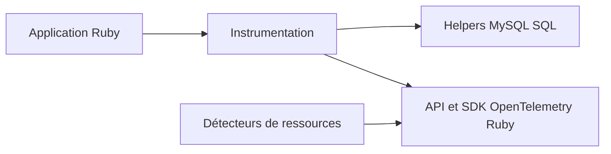

# open-telemetry/opentelemetry-ruby-contrib

> Paquets de contribution OpenTelemetry pour Ruby : instrumentation de gems populaires et détecteurs de ressources.

## Le problème
Instrumenter une appli Ruby (Rails, Rack, Sinatra) avec OpenTelemetry demande une instrumentation par bibliothèque.

## Ce que ça fait vraiment
Contient des bibliothèques d'instrumentation pour de nombreuses gems (Rails, Rack, Sinatra), des helpers partagés (MySQL, SQL Processor), la propagation de contexte OTTrace et Amazon X-Ray, et des détecteurs de ressources Azure, conteneur et Google Cloud. Ruby 3.3 ou plus requis depuis le 31 mars 2026.

## Comment c'est branché
Schéma simplifié d'après la fiche, sans diagramme fourni.

## Essayer
Aucune commande documentée : chaque gem a son propre README.

## Coût et pièges
Gratuit. Projet bénévole : les versions de Ruby ou de gems en fin de vie perdent leur support, avec épinglage obligatoire de l'ancienne version.

## Ce que ce n'est pas
Pas un SDK complet : il complète le SDK OpenTelemetry Ruby. Il faut du Ruby, absent de la liste des prérequis.

## Alternatives
Aucune alternative nommée dans le README.

## Pour toi
À ignorer : réservé aux applications Ruby, rare dans un parcours data, IA ou MLOps.

