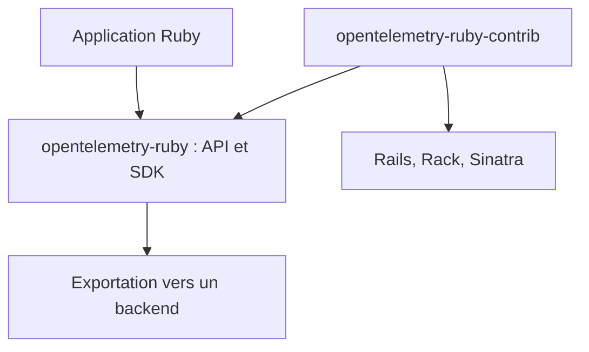

# open-telemetry/opentelemetry-ruby

> OpenTelemetry client for Ruby, aimed at developers instrumenting their Ruby applications.

## The problem
A Ruby application without standard instrumentation delivers no traces or metrics usable by an observability tool.

## What it actually does
This is the OpenTelemetry API and SDK for Ruby. The instrumentation libraries for common gems (Rails, Rack, Sinatra) live in a separate repository, opentelemetry-ruby-contrib. The project follows OpenTelemetry's versioning policy: experimental signals may stay at 0.x.

## How it is wired


## Trying it
```bash
# Aucune commande documentée dans le README : voir Getting Started (lien).
```

## Cost and gotchas
Free. You need a Ruby project and a collection backend of your choice; the installation (gem) is not described in the README.

## What it is not
It is not an observability backend: it produces telemetry, it does not store it. The instrumentations are elsewhere (contrib).

## Alternatives
- opentelemetry-ruby-contrib: for gem instrumentations, an indispensable complement.

## For you
Ignore unless you have Ruby services: the building block is solid on the community side, but Ruby is not your data / MLOps turf.
