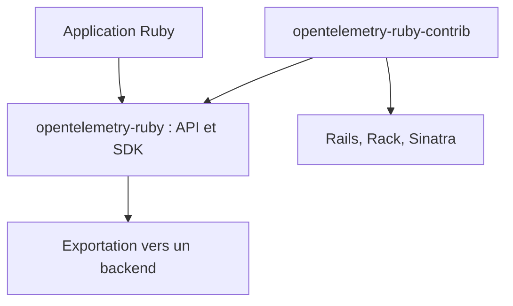

# open-telemetry/opentelemetry-ruby

> Client OpenTelemetry pour Ruby, destiné aux développeurs qui instrumentent leurs applications Ruby.

## Le problème
Une application Ruby sans instrumentation standard ne livre ni traces ni métriques exploitables par un outil d'observabilité.

## Ce que ça fait vraiment
C'est l'API et le SDK OpenTelemetry pour Ruby. Les bibliothèques d'instrumentation de gems courants (Rails, Rack, Sinatra) vivent dans un dépôt séparé, opentelemetry-ruby-contrib. Le projet suit la politique de versions d'OpenTelemetry : les signaux expérimentaux peuvent rester en 0.x.

## Comment c'est branché


## Essayer
```bash
# Aucune commande documentée dans le README : voir Getting Started (lien).
```

## Coût et pièges
Gratuit. Il faut un projet Ruby et un backend de collecte de ton choix ; l'installation (gem) n'est pas décrite dans le README.

## Ce que ce n'est pas
Ce n'est pas un backend d'observabilité : il produit la télémétrie, il ne la stocke pas. Les instrumentations sont ailleurs (contrib).

## Alternatives
- opentelemetry-ruby-contrib : pour les instrumentations de gems, complément indispensable.

## Pour toi
Ignorer sauf si tu as des services Ruby : la brique est solide côté communauté, mais Ruby n'est pas ton terrain data / MLOps.

