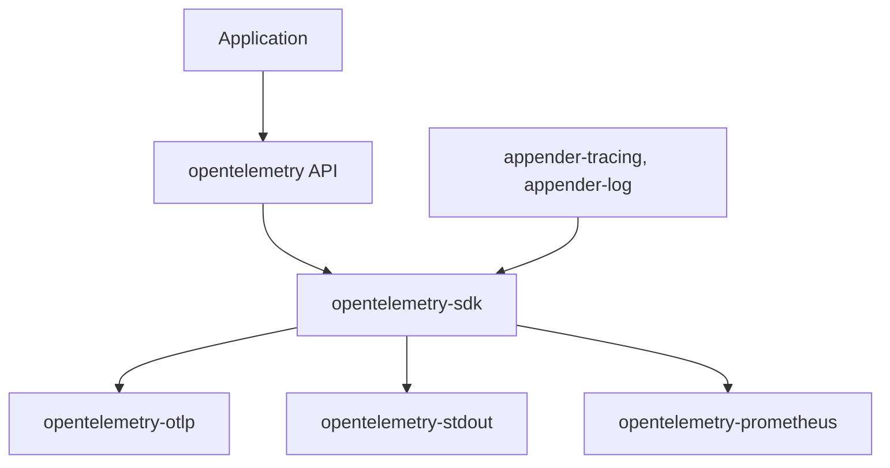

# open-telemetry/opentelemetry-rust

> Rust implementation of OpenTelemetry to instrument an application's logs, metrics and traces.

## The problem
Without a common standard, each service exports its observability data in its own way, and changing backend means rewriting the instrumentation.

## What it actually does
The crates provide the API (context, baggage, propagators, traces, metrics), the SDK that collects and processes, and exporters: OTLP to a collector or a backend, Prometheus and stdout for debugging. Adapters bridge the logs of the `log` and `tracing` crates. README status: logs and metrics API and SDK stable, traces in beta.

## How it is wired


## Trying it
```bash
# Aucune commande dans ce README : voir les exemples logs, métriques et traces du dossier examples, et basic-otlp-http pour OTLP.
```

## Cost and gotchas
Free; supported Rust versions are given in the README. Traces and the Prometheus exporter remain in beta, and the README warns that some components have unstable features.

## What it is not
It is not an analysis backend: it produces and exports telemetry, it does not store it. It does not introduce a new user-facing log API, only a bridge.

## Alternatives
The crates of the opentelemetry-rust-contrib repository and the OpenTelemetry registry for extensions, cited in the README.

## For you
Adopt: CNCF standard for Rust service observability, useful to any MLOps chain that exports metrics and traces.
