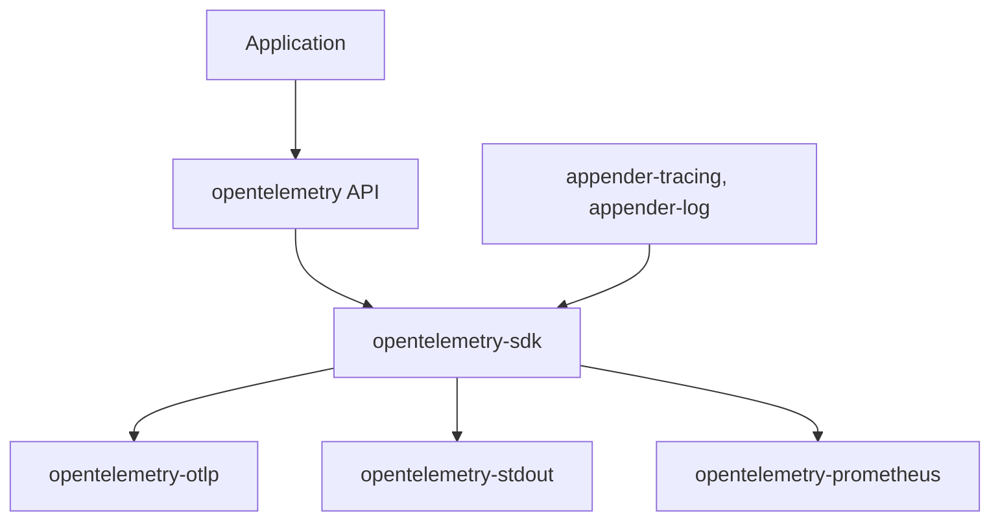

# open-telemetry/opentelemetry-rust

> Implémentation Rust d'OpenTelemetry pour instrumenter logs, métriques et traces d'une application.

## Le problème
Sans standard commun, chaque service exporte ses données d'observabilité à sa manière, et changer de backend impose de réécrire l'instrumentation.

## Ce que ça fait vraiment
Les crates fournissent l'API (contexte, baggage, propagateurs, traces, métriques), le SDK qui collecte et traite, et des exporteurs : OTLP vers un collecteur ou un backend, Prometheus et stdout pour le débogage. Des adaptateurs relient les logs des crates `log` et `tracing`. Statut du README : API et SDK des logs et métriques stables, traces en bêta.

## Comment c'est branché


## Essayer
```bash
# Aucune commande dans ce README : voir les exemples logs, métriques et traces du dossier examples, et basic-otlp-http pour OTLP.
```

## Coût et pièges
Gratuit ; des versions de Rust supportées sont indiquées dans le README. Les traces et l'exporteur Prometheus restent en bêta, et le README prévient que certains composants ont des fonctions instables.

## Ce que ce n'est pas
Ce n'est pas un backend d'analyse : il produit et exporte la télémétrie, il ne la stocke pas. Il n'introduit pas de nouvelle API de log utilisateur, seulement un pont.

## Alternatives
Les crates du dépôt opentelemetry-rust-contrib et le registre OpenTelemetry pour les extensions, cités dans le README.

## Pour toi
À adopter : standard CNCF pour l'observabilité de services Rust, utile à toute chaîne MLOps qui exporte des métriques et des traces.

