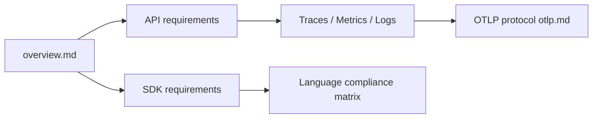

# open-telemetry/opentelemetry-specification

> Normative multi-language specification of OpenTelemetry, for those who implement or instrument.

## The problem
Implementations in different languages must stay compatible: traces, metrics and logs.

## What it actually does
Markdown repository of the specification: API, SDK, signals (traces, metrics, logs, profiling), shared concepts (context propagation, resource, baggage), semantic conventions, the OTLP protocol, a per-language compliance matrix. Versioned with SemVer. It is not a runtime.

## How it is wired

## Trying it
No command documented in the README: read the latest version at opentelemetry.io/docs/specs/otel.

## Cost and gotchas
Free. Read-only; decisions go through a proposal process (CONTRIBUTING.md).

## What it is not
Not a library nor a collector: you need one implementation per language.

## Alternatives
No alternative named in the README.

## For you
To adopt as a reference: foundation of observability for ML/MLOps pipelines and of instrumentation, under multi-company governance.
