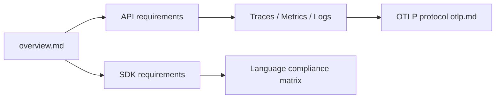

# open-telemetry/opentelemetry-specification

> Spécification normative multi-langages d'OpenTelemetry, pour qui implémente ou instrumente.

## Le problème
Des implémentations dans des langages différents doivent rester compatibles : traces, métriques et logs.

## Ce que ça fait vraiment
Dépôt Markdown de la spécification : API, SDK, signaux (traces, métriques, logs, profilage), concepts partagés (propagation de contexte, ressource, baggage), conventions sémantiques, protocole OTLP, matrice de conformité par langage. Versionnée en SemVer. Ce n'est pas un runtime.

## Comment c'est branché

## Essayer
Aucune commande documentée dans le README : lire la dernière version sur opentelemetry.io/docs/specs/otel.

## Coût et pièges
Gratuit. Réservé à la lecture ; les décisions passent par un processus de proposition (CONTRIBUTING.md).

## Ce que ce n'est pas
Pas une bibliothèque ni un collecteur : il faut une implémentation par langage.

## Alternatives
Aucune alternative nommée dans le README.

## Pour toi
À adopter comme référence : base de l'observabilité des pipelines ML/MLOps et de l'instrumentation, sous gouvernance multi-entreprises.

