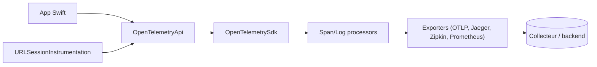

# open-telemetry/opentelemetry-swift

> OpenTelemetry client for Swift: API, SDK, exporters and instrumentation for Apple apps.

## The problem
Collecting traces, metrics and logs from a Swift app to an observability backend requires a client that conforms to the OpenTelemetry specification.

## What it actually does
`OpenTelemetryApi` defines the protocols and no-op implementations; `OpenTelemetrySdk` is the reference implementation. Exporters: Stdout, Jaeger, Zipkin, Prometheus, OTLP gRPC/HTTP. Instrumentation of `URLSession`, network state and signposts. Status: traces stable, logs in beta, metrics on an outdated specification; OTLP HTTP experimental, only gRPC is production-ready.

## How it is wired


## Trying it
```swift
.package(url: "https://github.com/open-telemetry/opentelemetry-swift", from: "2.2.0"),
.package(url: "https://github.com/open-telemetry/opentelemetry-swift-core.git", from: "2.2.0")
```
With CocoaPods: `pod 'OpenTelemetry-Swift-Sdk'`.

## Cost and gotchas
Free; a collector or backend must be supplied. Libraries should depend only on the API, the application chooses the SDK.

## What it is not
Not an observability backend nor a dashboard. Metrics follow an obsolete specification, according to the README.

## Alternatives
- Grafana/faro: third-party exporter cited in the README.

## For you
Ignore: useful only if you instrument a Swift app; for server-side MLOps, prefer the Python SDKs.
