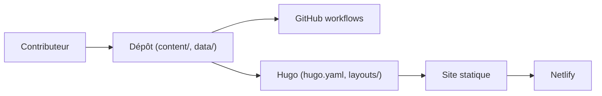

# open-telemetry/opentelemetry.io

> Sources of the OpenTelemetry website, documentation and blog, built with Hugo.

## The problem
The official OpenTelemetry docs need a single source that anyone can contribute to.

## What it actually does
A content repository: Markdown pages, blog, project registry (YAML/JSON data), translations (es, fr, ja, pt, zh), themes, scripts. The site is generated by Hugo and hosted on Netlify; GitHub workflows check spelling and links. The README mostly describes how to contribute and the roles (maintainers, approvers, triagers).

## How it is wired

## Trying it
No commands in the README. It points to the contributor guide (style and review) and to the "Submit a blog post" guide.

## Cost and gotchas
Free. 501 open issues: the docs move fast. CC-BY-4.0 license, suited to content rather than code.

## What it is not
Not the OpenTelemetry code (SDK, collector): only the website and documentation.

## Alternatives
The README cites no alternatives.

## For you
Adopt as a reading reference for observability of your ML pipelines and services; the repository requires no installation.
