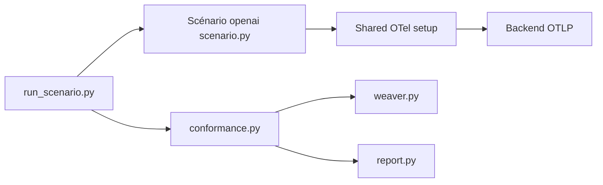

# open-telemetry/semantic-conventions-genai

> OpenTelemetry semantic conventions for generative AI: spans, metrics, events, MCP and providers.

## The problem
Each observability tool names LLM calls differently, which prevents comparing or correlating traces.

## What it actually does
Defines in YAML (model folder, managed with Weaver) conventions for GenAI clients, MCP and providers, and generates the readable docs. Contains Python reference implementations: scenarios (Anthropic, Bedrock, CrewAI, Google ADK, LangChain, OpenAI, Vertex) that emit telemetry, a conformance engine and coverage reports. The schema URL is still "TODO".

## How it is wired

## Trying it
No command documented in the README.

## Cost and gotchas
The reference scenarios call real providers (keys at your expense, judging by the scenario names; not detailed). Young repo, 182 open issues.

## What it is not
Not an instrumentation library to install: a specification and conformance examples. Not yet stabilized.

## Alternatives
No alternative cited in the README.

## For you
Worth watching: if you instrument LLM applications, this naming standard will become the reference; reading it is enough for now.
